<a id="top"></a>
<div align="center">

```text
  ██████╗ ███████╗███████╗ ██████╗ ██████╗  ██████╗ ███████╗
  ██╔══██╗██╔════╝██╔════╝██╔═══██╗██╔══██╗██╔════╝ ██╔════╝
  ██████╔╝█████╗  █████╗  ██║   ██║██████╔╝██║  ███╗█████╗  
  ██╔══██╗██╔══╝  ██╔══╝  ██║   ██║██╔══██╗██║   ██║██╔══╝  
  ██║  ██║███████╗██║     ╚██████╔╝██║  ██║╚██████╔╝███████╗
  ╚═╝  ╚═╝╚══════╝╚═╝      ╚═════╝ ╚═╝  ╚═╝ ╚═════╝ ╚══════╝
```

<h3>Run it once. Replay it forever.</h3>

<p>
  <b>Reforge</b> is a local-first computation cache for developer workflows.<br/>
  Wrap any deterministic command with <code>dcc exec</code>, and identical work<br/>
  becomes an instant, verified replay instead of a re-run.
</p>

<sub>
  <b>Developer Computation Cache (<code>dcc</code>)</b> &nbsp;·&nbsp;
  Content-addressed &nbsp;·&nbsp; Single-flight &nbsp;·&nbsp; Self-healing &nbsp;·&nbsp; Pure Rust
</sub>

<br/><br/>

```text
  $ dcc exec -i src/schema.proto -o gen/schema.rs -- protoc ...
    ✗ MISS   key 9f01ab2…   executed · 1 output captured

  $ dcc exec -i src/schema.proto -o gen/schema.rs -- protoc ...
    ✓ HIT    key 9f01ab2…   replayed from cache · command not run
```

<br/>


<!-- Badges -->
<table>
  <tr>
    <td align="center"><a href="https://www.rust-lang.org/"></a></td>
    <td align="center"><a href="Cargo.toml"></a></td>
    <td align="center"><a href="#cross-platform-support"></a></td>
    <td align="center"><a href="LICENSE"></a></td>
  </tr>
  <tr>
    <td align="center"><a href="#content-addressable-storage-cas"></a></td>
    <td align="center"><a href="#multi-strategy-eviction--gc"></a></td>
    <td align="center"><a href="#security--directory-escape-prevention"></a></td>
    <td align="center"><a href="#testing--verification"></a></td>
  </tr>
</table>

<br/>

<!-- Navigation -->
<table>
  <tr>
    <th align="center">🚀 &nbsp;Get Started</th>
    <th align="center">🧠 &nbsp;Understand It</th>
    <th align="center">🛡️ &nbsp;Trust It</th>
  </tr>
  <tr>
    <td align="left" valign="top">
      <a href="#quick-start-guide"><b>Quick Start</b></a><br/>
      <a href="#cli-command-reference">CLI Reference</a><br/>
      <a href="#polyglot-integrations">Tool Integrations</a><br/>
      <a href="#what-problem-does-this-solve">Why Reforge?</a>
    </td>
    <td align="left" valign="top">
      <a href="#core-guarantee"><b>Core Guarantee</b></a><br/>
      <a href="#architecture-overview">Architecture</a><br/>
      <a href="#invalidation-engine--cryptographic-hashing">Cache Keys</a><br/>
      <a href="#concurrency-and-single-flight-execution">Concurrency</a>
    </td>
    <td align="left" valign="top">
      <a href="#security--directory-escape-prevention"><b>Security</b></a><br/>
      <a href="#self-healing--quarantine">Self-Healing</a><br/>
      <a href="#testing--verification">Testing</a><br/>
      <a href="#cross-platform-support">Platforms</a>
    </td>
  </tr>
</table>

<sub>
  ⌨️ &nbsp;<code>cargo install --path crates/cache-cli</code> &nbsp;→&nbsp;
  <code>dcc exec -- &lt;your command&gt;</code> &nbsp;→&nbsp; done.
</sub>


<!-- How it works -->
<h3>⚙️ How a run works</h3>

<table>
  <tr>
    <td align="center" width="25%" valign="top">
      <h3>①</h3>
      <b>Fingerprint</b><br/>
      <sub>Hash the inputs, command, declared env vars, tool binary and platform into one key.</sub>
    </td>
    <td align="center" width="25%" valign="top">
      <h3>②</h3>
      <b>Look Up</b><br/>
      <sub>Check the content-addressed store. Every object is verified against its digest before use.</sub>
    </td>
    <td align="center" width="25%" valign="top">
      <h3>③</h3>
      <b>Run or Replay</b><br/>
      <sub>Miss: take the lock and execute. Hit, or lost the race: replay the stored result.</sub>
    </td>
    <td align="center" width="25%" valign="top">
      <h3>④</h3>
      <b>Restore Atomically</b><br/>
      <sub>Outputs are staged in a temp location, then renamed into place. No half-written files.</sub>
    </td>
  </tr>
</table>

<sub>
  <b>Miss</b> → ① ② ③ (execute &amp; store) ④ &nbsp;&nbsp;|&nbsp;&nbsp;
  <b>Hit</b> → ① ② ④ (command never runs) &nbsp;&nbsp;|&nbsp;&nbsp;
  <b>Can't verify</b> → falls back to running the command
</sub>

</div>

<br/>


<br>

<a id="core-guarantee"></a>
## ⚖️ Core Guarantee

<div align="left">

> ### A cache hit must never change the result of a computation.
> If Reforge cannot show that a stored result matches what a fresh run would produce,
> **it runs the command.** Being slow is acceptable. Being wrong is not.

</div>

<br/>

### 🤝 The contract

The guarantee has two sides. Reforge does its part only if the declared inputs describe the command's real inputs.

<table>
  <tr>
    <th width="33%" align="left">✅ Reforge guarantees</th>
    <th width="33%" align="left">📝 You provide</th>
    <th width="34%" align="left">↩️ Otherwise, it falls back</th>
  </tr>
  <tr valign="top">
    <td>
      A hit is replayed only when the key matches exactly and every stored object passes its SHA-256 check.<br/><br/>
      Outputs are restored atomically, so your workspace never holds half-written files.
    </td>
    <td>
      A <b>deterministic command</b>: same inputs, same outputs.<br/><br/>
      <b>Complete declarations</b>: every file the command reads (<code>-i</code>), every environment variable it depends on (<code>-e</code>), every file it writes (<code>-o</code>).
    </td>
    <td>
      Corrupt or unverifiable entry: quarantined, then recomputed.<br/><br/>
      Lock contention or a crashed worker: the next runner executes cleanly.<br/><br/>
      Any doubt about a stored result: the command runs.
    </td>
  </tr>
</table>

> [!IMPORTANT]
> **What the key can't see.** Reforge hashes what you declare. Files the command reads but you didn't list, the current time, random numbers, network responses and undeclared environment variables are invisible to it. If the command's output depends on any of them, a hit can be stale. Declare everything the command reads, and don't cache commands that aren't deterministic.

<br/>

### 🧱 The six pillars

<table>
  <tr>
    <th width="26%" align="left">Pillar</th>
    <th width="46%" align="left">What it does</th>
    <th width="28%" align="left">Why it matters</th>
  </tr>
  <tr valign="top">
    <td><b>🏛️ Content-Addressed Storage</b></td>
    <td>Files, stdout, stderr and exit codes are stored under their SHA-256 digests. Identical outputs from different tasks share one physical copy.</td>
    <td>Every read is checked against its address, so silent corruption can't be replayed.</td>
  </tr>
  <tr valign="top">
    <td><b>🔑 Five-Vector Cache Key</b></td>
    <td>The key combines input file contents, command and arguments, declared environment variables, the executable's content hash and version, and the platform (OS, architecture, pointer width, endianness).</td>
    <td>Change any one of them and the key changes, so stale entries are never matched.</td>
  </tr>
  <tr valign="top">
    <td><b>🏎️ Single-Flight Execution</b></td>
    <td>A cross-process advisory lock per cache key. Racing runners wait, then replay the winner's result. Verified with a 50+ process stress harness.</td>
    <td>No duplicate work on parallel CI workers, and the OS releases the lock if a runner is killed.</td>
  </tr>
  <tr valign="top">
    <td><b>📦 Atomic Restoration</b></td>
    <td>Outputs are staged in a temporary location, then renamed into place.</td>
    <td>An interrupted restore never leaves a corrupt or partial workspace.</td>
  </tr>
  <tr valign="top">
    <td><b>🛡️ Self-Healing Quarantine</b></td>
    <td>Entries that fail checksum verification are moved to a quarantine ledger, and the command is run fresh.</td>
    <td>Bad data is kept for inspection and never reaches your workspace.</td>
  </tr>
  <tr valign="top">
    <td><b>⚙️ Bounded Eviction</b></td>
    <td>A hard disk-usage limit with <b>LRU</b>, <b>LFU</b> or <b>FIFO</b> policies, plus garbage collection of unreferenced objects.</td>
    <td>The cache can't grow without limit, and oversized objects are rejected before they are stored.</td>
  </tr>
</table>

<br>

<a id="what-problem-does-this-solve"></a>
## 💡 What Problem Does This Solve?

Developers re-run the same deterministic work all day. You edit one file, and the whole toolchain runs again over hundreds of files that didn't change. On CI it's worse, because every runner repeats what another runner just finished. That costs CPU time, battery, CI minutes and, most of all, waiting.

<table>
  <tr>
    <th width="50%" align="left">❌ Without Reforge</th>
    <th width="50%" align="left">✅ With Reforge</th>
  </tr>
  <tr valign="top">
    <td>
      Every command runs in full, every time.<br/>
      Timestamps decide "did it change?", and they break on git checkouts and fresh clones.<br/>
      Parallel CI jobs all redo the same work.<br/>
      Each tool has its own caching rules, or none.
    </td>
    <td>
      Unchanged work is replayed from the cache instead of re-run.<br/>
      File <b>contents</b> decide, so a checkout that touches timestamps doesn't invalidate anything.<br/>
      Racing runners wait for one result and share it.<br/>
      One wrapper, <code>dcc exec</code>, behaves the same for every tool.
    </td>
  </tr>
</table>

<br/>

### 🎯 Where it pays off

<table>
  <tr>
    <th width="26%" align="left">Workload</th>
    <th width="44%" align="left">The waste</th>
    <th width="30%" align="left">Typical tools</th>
  </tr>
  <tr valign="top">
    <td><b>⚙️ Code generators</b></td>
    <td>Regenerating whole trees when no schema changed.</td>
    <td>Protobuf, OpenAPI, GraphQL, FlatBuffers</td>
  </tr>
  <tr valign="top">
    <td><b>🧹 Linters &amp; formatters</b></td>
    <td>Re-scanning thousands of untouched files.</td>
    <td>ESLint, Prettier, Clippy, Black, Ruff</td>
  </tr>
  <tr valign="top">
    <td><b>📦 Asset bundlers</b></td>
    <td>Rebuilding unchanged style and script trees.</td>
    <td>Webpack, esbuild, Tailwind, PostCSS</td>
  </tr>
  <tr valign="top">
    <td><b>🔨 Compilers</b></td>
    <td>Recompiling the same sources across branches and CI jobs.</td>
    <td>C/C++, Rust, Go, TypeScript</td>
  </tr>
</table>

<br/>

### 🔌 How it fits

`dcc` is a wrapper. It doesn't replace your tools or ask you to change your build system. Put `dcc exec` in front of a command, declare what the command reads and writes, and Reforge handles the rest.

```bash
dcc exec -i src/schema.proto -o gen/schema.rs -- protoc --rust_out=gen src/schema.proto
```

<br/>

### 🚦 Is it right for your task?

<table>
  <tr>
    <th width="50%" align="left">👍 A good fit</th>
    <th width="50%" align="left">👎 Not a good fit</th>
  </tr>
  <tr valign="top">
    <td>
      The output depends only on declared files, arguments and environment variables.<br/>
      The command is slow compared to hashing its inputs.<br/>
      You re-run it often with unchanged inputs.<br/>
      You want the same caching across several tools.
    </td>
    <td>
      The output depends on the clock, randomness or the network.<br/>
      The command reads files you can't list up front.<br/>
      It's already fast, so hashing costs about as much as running it.<br/>
      It has side effects beyond its declared outputs, such as deploys or database writes.
    </td>
  </tr>
</table>

> [!NOTE]
> Many tools have their own caches, such as ESLint's `--cache` or Cargo's incremental compilation. Reforge doesn't compete with them. It caches the **whole command's result** at a layer above them, using the same rules for every tool. Cache hits are only as safe as your declarations, as described in the [Core Guarantee](#core-guarantee).

<br>

<a id="benchmark-reforge-vs-traditional-caches"></a>
## ⚔️ Performance & Comparison

<div align="center">

```text
 ┌─────────────────────────────────────────────────────────────────────────────┐
 │  WITHOUT REFORGE     ████████████████████████████████████  full command run │
 │  (every time)                                                               │
 ├─────────────────────────────────────────────────────────────────────────────┤
 │  REFORGE · MISS      ████████████████████████████████████▒ run + store      │
 │  (first time)                                                               │
 ├─────────────────────────────────────────────────────────────────────────────┤
 │  REFORGE · HIT       █▒                                    hash + restore   │
 │  (unchanged inputs)                                                         │
 └─────────────────────────────────────────────────────────────────────────────┘
   
   Illustrative, not to scale. ▒ = Reforge's overhead. Hit cost grows with input/output size.
```

</div>

A miss costs the command's runtime plus a small overhead to store the result. A hit swaps the command's runtime for hashing, verifying and restoring. That's a big win for slow commands and little or none for fast ones.

<br/>

### 🧭 Capability comparison

<table>
  <tr>
    <th width="34%" align="left">Capability</th>
    <th width="22%" align="center">⏱️ Timestamp scripts</th>
    <th width="22%" align="center">🔧 Single-tool caches</th>
    <th width="22%" align="center">⬢ Reforge</th>
  </tr>
  <tr>
    <td><b>🔒 Content-based change detection</b><br/><sub>SHA-256 of inputs, command, env, tool, platform</sub></td>
    <td align="center">❌</td><td align="center">◐</td><td align="center">✅</td>
  </tr>
  <tr>
    <td><b>🌐 Works with any command</b><br/><sub>one wrapper for every tool</sub></td>
    <td align="center">◐</td><td align="center">❌</td><td align="center">✅</td>
  </tr>
  <tr>
    <td><b>🏎️ Single-flight execution</b><br/><sub>racing runners wait and replay one result</sub></td>
    <td align="center">❌</td><td align="center">◐</td><td align="center">✅</td>
  </tr>
  <tr>
    <td><b>🛡️ Corruption detection + quarantine</b><br/><sub>verify on read, recompute on failure</sub></td>
    <td align="center">❌</td><td align="center">◐</td><td align="center">✅</td>
  </tr>
  <tr>
    <td><b>🧹 Bounded disk use</b><br/><sub>LRU, LFU or FIFO with garbage collection</sub></td>
    <td align="center">❌</td><td align="center">◐</td><td align="center">✅</td>
  </tr>
  <tr>
    <td><b>🔐 Output path confinement</b><br/><sub>canonical paths, symlink-escape rejection</sub></td>
    <td align="center">❌</td><td align="center">◐</td><td align="center">✅</td>
  </tr>
  <tr>
    <td><b>💻 Native on Windows, macOS, Linux</b></td>
    <td align="center">◐</td><td align="center">◐</td><td align="center">✅</td>
  </tr>
  <tr>
    <td><b>☁️ Shared remote cache</b><br/><sub>one cache across machines</sub></td>
    <td align="center">❌</td><td align="center">◐</td><td align="center">❌</td>
  </tr>
</table>

<sub>✅ built in &nbsp;·&nbsp; ◐ varies by tool or partial &nbsp;·&nbsp; ❌ not provided. This compares <b>approaches</b>, not specific products.</sub>

<br/>

### 🔬 Measure it on your own project

Hit time depends on how many bytes are hashed and restored, so results on your project matter more than any generic number. [`hyperfine`](https://github.com/sharkdp/hyperfine) makes it a few commands.

**Install hyperfine:**

```bash
cargo install hyperfine
```

**Create the demo file** (skip this if you already did the [Quick Start](#quick-start-guide)):

```bash
echo 'fn main() { println!("hello from a cached build"); }' > hello.rs
```

<br/>

#### 🥶 Cold run: every run is a miss

Wipes the cache before each run, so `dcc` always executes the command.

**Linux / macOS:**

```bash
hyperfine --prepare 'rm -rf .dcc' 'dcc exec -i hello.rs -o hello -- rustc hello.rs -o hello'
```

**Windows:**

```powershell
hyperfine --prepare 'rmdir /s /q .dcc' 'dcc exec -i hello.rs -o hello.exe -- rustc hello.rs -o hello.exe'
```

<br/>

#### 🔥 Warm run: every run is a hit

One warm-up run fills the cache, then every timed run is a replay.

**Linux / macOS:**

```bash
hyperfine --warmup 1 'dcc exec -i hello.rs -o hello -- rustc hello.rs -o hello'
```

**Windows:**

```powershell
hyperfine --warmup 1 'dcc exec -i hello.rs -o hello.exe -- rustc hello.rs -o hello.exe'
```

<br/>

#### 📏 Baseline: the same command without Reforge

**Linux / macOS:**

```bash
hyperfine 'rustc hello.rs -o hello'
```

**Windows:**

```powershell
hyperfine 'rustc hello.rs -o hello.exe'
```

<br/>

> [!TIP]
> **Compare the three results.** The warm run should be far faster than the baseline, and the cold run should be slightly slower than the baseline (the extra time is the cost of storing the result). To test your own command, replace `hello.rs`, `hello` and the `rustc` part with your real inputs, outputs and command.

> [!NOTE]
> A tiny demo like this will flatter the hit time. For numbers you can quote, use a real project with realistic input and output sizes.

<details>
<summary><b>📊 Results table (fill in after you run the commands)</b></summary>

<br/>

| Workload | Baseline | Reforge miss | Reforge hit | Speedup |
| :--- | :---: | :---: | :---: | :---: |
| _your workload_ | _ms_ | _ms_ | _ms_ | _×_ |

Include your machine (CPU, RAM, disk, OS), the Reforge version, and the number of runs.

</details>

<br/>

### ⚖️ Honest limits

- **Not always faster.** For commands that finish in milliseconds, hashing can cost as much as running them.
- **Local only.** There's no shared remote cache across machines.
- **As safe as your declarations.** See the [Core Guarantee](#core-guarantee).


<br>

<a id="quick-start-guide"></a>
## 🚀 Quick Start Guide

Install, cache a command, and see a hit in about two minutes.

<table>
  <tr>
    <td align="center" width="25%"><h3>①</h3><b>Install</b><br/><sub>build the <code>dcc</code> binary</sub></td>
    <td align="center" width="25%"><h3>②</h3><b>Cache a command</b><br/><sub>first run is a miss</sub></td>
    <td align="center" width="25%"><h3>③</h3><b>Replay it</b><br/><sub>second run is a hit</sub></td>
    <td align="center" width="25%"><h3>④</h3><b>Inspect &amp; manage</b><br/><sub>stats, verify, prune</sub></td>
  </tr>
</table>

<br/>

### 1️⃣ Install

**Requires:** [Rust](https://www.rust-lang.org/tools/install) 1.77 or newer, and Git.

**Clone the repository:**

```bash
git clone https://github.com/Ashish6298/Reforge.git
```

**Enter the project folder:**

```bash
cd Reforge
```

**Install `dcc` onto your PATH:**

```bash
cargo install --path crates/cache-cli
```

**Check it worked:**

```bash
dcc --help
```

<details>
<summary><b>Prefer not to install? Build and run in place</b></summary>

<br/>

**Build:**

```bash
cargo build --release --workspace
```

**Run (Linux / macOS):**

```bash
./target/release/dcc --help
```

**Run (Windows):**

```powershell
.\target\release\dcc.exe --help
```

</details>

<br/>

### 2️⃣ Cache your first command

This demo compiles a tiny Rust file, so it needs nothing beyond the toolchain you just installed. Run these in any empty folder.

**Create the source file:**

```bash
echo 'fn main() { println!("hello from a cached build"); }' > hello.rs
```

**First run: cache MISS.** The command really runs, and `dcc` stores the result.

```bash
dcc exec -i hello.rs -o hello -- rustc hello.rs -o hello
```

**Delete the output (Linux / macOS):**

```bash
rm hello
```

**Delete the output (Windows):**

```powershell
del hello.exe
```

**Second run: cache HIT.** Run the exact same command again. `rustc` never runs, and `dcc` restores `hello` from the store.

```bash
dcc exec -i hello.rs -o hello -- rustc hello.rs -o hello
```

**Run the restored program (Linux / macOS):**

```bash
./hello
```

**Run the restored program (Windows):**

```powershell
.\hello.exe
```

You should see:

```text
hello from a cached build
```

<sub>On Windows, use <code>-o hello.exe</code> and <code>-o hello.exe</code> in place of <code>hello</code> in the <code>dcc exec</code> and <code>rustc</code> parts. Exact log lines vary by version, and <code>dcc stats</code> shows the hit and miss counts.</sub>

> [!TIP]
> **Prove that invalidation works.** Change one character in `hello.rs` and run the `dcc exec` command again. It becomes a miss, because the input hash changed. Revert the edit and it's a hit again.

<br/>

### 3️⃣ Use it on a real command

The flags mean:

<table>
  <tr>
    <th width="22%" align="left">Flag</th>
    <th width="43%" align="left">Meaning</th>
    <th width="35%" align="left">Rule of thumb</th>
  </tr>
  <tr valign="top">
    <td><code>-i</code>, <code>--input</code></td>
    <td>A file or directory the command <b>reads</b>. Repeat the flag for more.</td>
    <td>List <b>everything</b> it reads.</td>
  </tr>
  <tr valign="top">
    <td><code>-o</code>, <code>--output</code></td>
    <td>A file or directory the command <b>writes</b>. These are captured and restored.</td>
    <td>List everything it produces.</td>
  </tr>
  <tr valign="top">
    <td><code>-e</code>, <code>--env</code></td>
    <td>An environment variable that affects the result.</td>
    <td>Add flags, targets and toggles.</td>
  </tr>
</table>

**Protobuf example.** Declare the schema and every file it imports:

```bash
dcc exec -i proto/ -o gen/ -- protoc --proto_path=proto --rust_out=gen proto/schema.proto
```

> [!WARNING]
> **A hit is only as safe as your declarations.** If the command reads a file you didn't pass with `-i`, changing that file won't invalidate the cache and you'll get a stale result. Above, the whole `proto/` directory is declared so imported files count. See the [Core Guarantee](#core-guarantee).

<br/>

### 4️⃣ Check health and manage storage

**Show usage, hit/miss counts and capacity:**

```bash
dcc stats
```

**Scan for corrupted objects:**

```bash
dcc verify
```

**Quarantine and recover bad entries:**

```bash
dcc verify --repair
```

**Preview what pruning would remove (always do this first):**

```bash
dcc prune --strategy lru --max-size-mb 500 --dry-run
```

**Enforce the size limit:**

```bash
dcc prune --strategy lru --max-size-mb 500
```

<sub>Strategies: <code>lru</code>, <code>lfu</code>, <code>fifo</code>.</sub>

<br/>

### 🩺 Troubleshooting

<table>
  <tr>
    <th width="38%" align="left">Symptom</th>
    <th width="62%" align="left">Likely cause and fix</th>
  </tr>
  <tr valign="top">
    <td><b>Always a miss</b></td>
    <td>Something in the key changes every run: a timestamp in an input, a generated file listed under <code>-i</code>, or a changing environment variable in <code>-e</code>.</td>
  </tr>
  <tr valign="top">
    <td><b>A hit, but the result looks stale</b></td>
    <td>The command reads something you didn't declare. Add it with <code>-i</code> or <code>-e</code>.</td>
  </tr>
  <tr valign="top">
    <td><b>Outputs missing after a hit</b></td>
    <td>The command wrote files that weren't declared with <code>-o</code>, so they weren't captured.</td>
  </tr>
  <tr valign="top">
    <td><b><code>dcc: command not found</code></b></td>
    <td>Cargo's bin directory isn't on your <code>PATH</code> (usually <code>~/.cargo/bin</code>), or you skipped the install step.</td>
  </tr>
</table>

<br>

<a id="architecture-overview"></a>
## 🏛️ Architecture Overview

Reforge is a Rust workspace of six crates. Each one has a single job, and the layers depend on each other in one direction only. Hashing knows nothing about storage, storage knows nothing about processes, and the CLI is a thin shell over the rest.

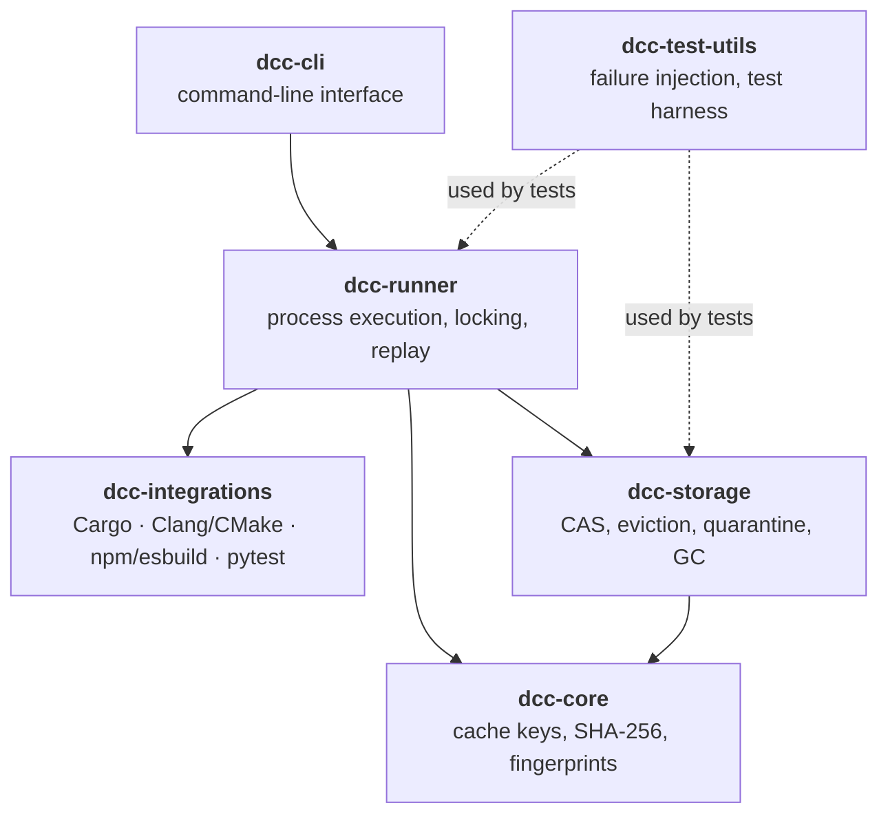

<sub>Arrows mean "depends on". Dotted arrows are test-only dependencies.</sub>

<br/>

### 🧱 The six crates

<table>
  <tr>
    <th width="21%" align="left">Crate</th>
    <th width="17%" align="left">Folder</th>
    <th width="62%" align="left">Responsibility</th>
  </tr>
  <tr valign="top">
    <td><b>🧬 <code>dcc-core</code></b><br/><sub>foundation</sub></td>
    <td><a href="crates/cache-core"><code>cache-core</code></a></td>
    <td>Domain models and <code>CacheKey</code> composition. SHA-256 hashing, tool fingerprinting, environment normalization and platform definitions. It has no knowledge of disks or processes.</td>
  </tr>
  <tr valign="top">
    <td><b>🗄️ <code>dcc-storage</code></b><br/><sub>persistence</sub></td>
    <td><a href="crates/cache-storage"><code>cache-storage</code></a></td>
    <td>The on-disk content-addressed store. Chunked metadata persistence, atomic file staging, LRU / LFU / FIFO eviction, the quarantine ledger and garbage collection of unreferenced objects.</td>
  </tr>
  <tr valign="top">
    <td><b>⚙️ <code>dcc-runner</code></b><br/><sub>execution</sub></td>
    <td><a href="crates/cache-runner"><code>cache-runner</code></a></td>
    <td>Runs the command and captures stdout, stderr, exit code and file changes. Enforces path confinement, restores outputs atomically, and handles cross-process single-flight locking.</td>
  </tr>
  <tr valign="top">
    <td><b>💻 <code>dcc-cli</code></b><br/><sub>interface</sub></td>
    <td><a href="crates/cache-cli"><code>cache-cli</code></a></td>
    <td>The <code>dcc</code> command. Colored output for people and JSON output for scripts.</td>
  </tr>
  <tr valign="top">
    <td><b>🔌 <code>dcc-integrations</code></b><br/><sub>tool adapters</sub></td>
    <td><a href="crates/cache-integrations"><code>cache-integrations</code></a></td>
    <td>Adapters and automated speedup benchmarks for Cargo, Clang/CMake, npm/esbuild and Python pytest.</td>
  </tr>
  <tr valign="top">
    <td><b>🧪 <code>dcc-test-utils</code></b><br/><sub>testing</sub></td>
    <td><a href="crates/cache-test-utils"><code>cache-test-utils</code></a></td>
    <td>Multi-OS test harness, chaos failure injectors, corrupted-byte injectors and mock execution environments.</td>
  </tr>
</table>

<br/>

### 🔁 Life of one `dcc exec` call

This shows which crate does the work at each step of the [run flow](#benchmark-reforge-vs-traditional-caches).

<table>
  <tr>
    <th width="6%" align="center">#</th>
    <th width="54%" align="left">What happens</th>
    <th width="40%" align="left">Crate</th>
  </tr>
  <tr valign="top"><td align="center">1</td><td>Parse flags and start the run.</td><td><code>dcc-cli</code></td></tr>
  <tr valign="top"><td align="center">2</td><td>Hash inputs, command, declared env vars, tool binary and platform into a <code>CacheKey</code>.</td><td><code>dcc-core</code></td></tr>
  <tr valign="top"><td align="center">3</td><td>Look up the key and verify stored objects against their digests. A failed check moves the entry to quarantine.</td><td><code>dcc-storage</code></td></tr>
  <tr valign="top"><td align="center">4</td><td>On a miss, take the per-key lock, check again, then execute and capture the result.</td><td><code>dcc-runner</code></td></tr>
  <tr valign="top"><td align="center">5</td><td>Write the result into the store and apply eviction limits.</td><td><code>dcc-storage</code></td></tr>
  <tr valign="top"><td align="center">6</td><td>Confine output paths to the workspace, then stage and rename them into place.</td><td><code>dcc-runner</code></td></tr>
</table>

<br/>

### 🧭 Where to look when you want to change something

<table>
  <tr>
    <th width="50%" align="left">I want to…</th>
    <th width="50%" align="left">Start in</th>
  </tr>
  <tr valign="top"><td>Change what goes into the cache key</td><td><code>crates/cache-core</code></td></tr>
  <tr valign="top"><td>Add an eviction strategy or change the store layout</td><td><code>crates/cache-storage</code></td></tr>
  <tr valign="top"><td>Change locking, sandboxing or output restoration</td><td><code>crates/cache-runner</code></td></tr>
  <tr valign="top"><td>Add a CLI flag or output format</td><td><code>crates/cache-cli</code></td></tr>
  <tr valign="top"><td>Add support or benchmarks for another tool</td><td><code>crates/cache-integrations</code></td></tr>
  <tr valign="top"><td>Simulate a crash or corrupted file in a test</td><td><code>crates/cache-test-utils</code></td></tr>
</table>

<br/>

### 🧪 Test one crate at a time

**Core:**

```bash
cargo test -p dcc-core
```

**Storage:**

```bash
cargo test -p dcc-storage
```

**Runner:**

```bash
cargo test -p dcc-runner
```


<br>

<a id="content-addressable-storage-cas"></a>
## 📦 Content-Addressable Storage (CAS)

<div align="center">

```text
 ┌──────────────────────────────────────────────────────────────────────────────┐
 │                                                                              │
 │    CacheKey ──────►  ENTRY  ───────►  OBJECT   OBJECT   OBJECT               │
 │   (what you ran)    (the recipe)     (stdout)  (stderr)  (output file)       │
 │                                                                              │
 │                     entries/9f/…      objects/3a/…  objects/e7/…             │
 │                                                                              │
 └──────────────────────────────────────────────────────────────────────────────┘
      An entry says WHAT a run produced. Objects hold the bytes themselves.
```

</div>

The store keeps two kinds of records. **Objects** hold raw bytes and are named after the SHA-256 of those bytes. **Entries** map a cache key to the list of object digests a run produced. Splitting them is what makes de-duplication and verification cheap.

<br/>

### 🗂️ On-disk layout

```text
.dcc/
├── cas/
│   ├── objects/
│   │   ├── 3a/
│   │   │   └── 3a89f4b…      raw output payload bytes
│   │   └── e7/
│   │       └── e712c90…      raw output payload bytes
│   ├── entries/
│   │   └── 9f/
│   │       └── 9f01ab2…      metadata: cache key → object digests
│   └── quarantine/
│       └── corrupted_entries/
└── locks/
    └── <key_hash>.lock       one advisory lock per cache key
```

<table>
  <tr>
    <th width="22%" align="left">Path</th>
    <th width="40%" align="left">What lives there</th>
    <th width="38%" align="left">Addressed by</th>
  </tr>
  <tr valign="top">
    <td><code>cas/objects/</code></td>
    <td>Raw bytes: output files, stdout, stderr.</td>
    <td>SHA-256 of the <b>content</b></td>
  </tr>
  <tr valign="top">
    <td><code>cas/entries/</code></td>
    <td>Metadata linking one cache key to the digests of its objects.</td>
    <td>The <b>cache key</b></td>
  </tr>
  <tr valign="top">
    <td><code>cas/quarantine/</code></td>
    <td>Entries that failed verification, kept for inspection.</td>
    <td>Never replayed</td>
  </tr>
  <tr valign="top">
    <td><code>locks/</code></td>
    <td>One lock file per key, for <a href="#concurrency-and-single-flight-execution">single-flight execution</a>.</td>
    <td>The cache key</td>
  </tr>
</table>

<sub>Objects and entries sit in subfolders named after the first two characters of their hash (<code>3a/</code>, <code>9f/</code>). That keeps any one folder from holding a huge number of files.</sub>

<br/>

### ♻️ De-duplication in practice

Because an object's name is its content hash, two tasks that produce the same bytes share one file, no matter what the tasks were.

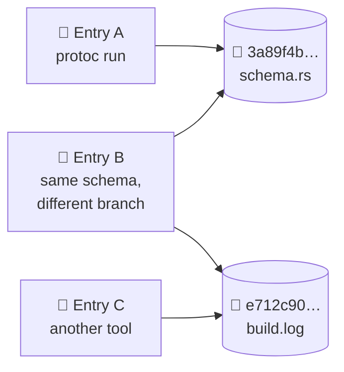

<sub>Entries A and B both point at <code>3a89f4b…</code>, so its bytes are stored once. Removing one entry doesn't delete an object another entry still uses, and <a href="#multi-strategy-eviction--gc">garbage collection</a> removes an object only when nothing refers to it.</sub>

<br/>

### ✍️ Write path: readers never see half a file

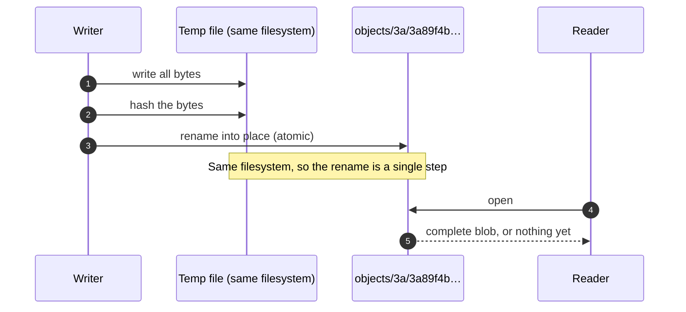

<table>
  <tr>
    <th width="30%" align="left">Step</th>
    <th width="70%" align="left">Why it's done this way</th>
  </tr>
  <tr valign="top">
    <td><b>Write to a temp file first</b></td>
    <td>A crash mid-write can only leave a stray temp file, never a damaged object under a real name.</td>
  </tr>
  <tr valign="top">
    <td><b>Temp file on the same filesystem</b></td>
    <td>A rename within one filesystem is atomic. Across filesystems it turns into a copy, which isn't.</td>
  </tr>
  <tr valign="top">
    <td><b>Rename into the final path</b></td>
    <td>At every moment, a reader sees either no object or the complete one.</td>
  </tr>
</table>

<br/>

### 🔍 Read path: verify before you trust

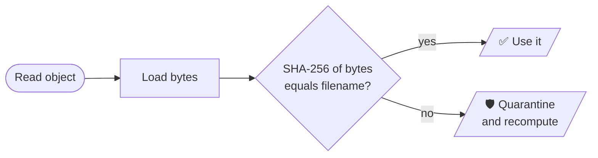

An object's name is the hash of what it should contain, so the check needs no extra bookkeeping. It re-hashes the bytes and compares. If a disk fault, an interrupted write or tampering changed even one byte, the hash won't match, and the bytes are never restored into your workspace.

<br/>

### 🧭 What the design gives you

<table>
  <tr>
    <th width="28%" align="left">Property</th>
    <th width="42%" align="left">How the store provides it</th>
    <th width="30%" align="left">Result</th>
  </tr>
  <tr valign="top">
    <td><b>💾 Space efficiency</b></td>
    <td>Identical content maps to one object path.</td>
    <td>Duplicate outputs cost disk once.</td>
  </tr>
  <tr valign="top">
    <td><b>⚛️ Atomic writes</b></td>
    <td>Temp file plus rename on the same filesystem.</td>
    <td>No partial blobs are ever visible.</td>
  </tr>
  <tr valign="top">
    <td><b>✅ Self-verifying reads</b></td>
    <td>The filename is the expected hash.</td>
    <td>Corruption is detected on every read.</td>
  </tr>
  <tr valign="top">
    <td><b>🔒 Immutable objects</b></td>
    <td>A name always means the same bytes. Changing content changes the name.</td>
    <td>No in-place edits to go wrong.</td>
  </tr>
  <tr valign="top">
    <td><b>🧹 Safe cleanup</b></td>
    <td>Entries are separate from objects, so unreferenced objects can be found and removed.</td>
    <td>Eviction and GC don't break live entries.</td>
  </tr>
</table>

<br/>

### 🔎 Explore your own store

**See usage, hit and miss counts, and capacity:**

```bash
dcc stats
```

**Machine-readable stats:**

```bash
dcc stats --json
```

**Check every object against its digest:**

```bash
dcc verify
```

**List quarantined entries:**

```bash
dcc quarantine list
```

**Browse the objects folder (Linux / macOS):**

```bash
ls .dcc/cas/objects
```

**Browse the objects folder (Windows):**

```powershell
dir .dcc\cas\objects
```

> [!NOTE]
> Treat `.dcc/` as managed by `dcc`. Don't edit or delete files inside it by hand. Use [`dcc prune`](#multi-strategy-eviction--gc) to shrink the cache and `dcc verify` to check it. A hand-edited object fails its hash check, and the entry that used it is quarantined.
<br>

<a id="invalidation-engine--cryptographic-hashing"></a>
## 🔒 Invalidation Engine & Cryptographic Hashing

<div align="center">

```text
 ┌──────────────────────────────────────────────────────────────────────────────┐
 │                                                                              │
 │    📄 inputs   ⌨️ command   🌱 env   🔧 tool   💻 platform                 │
 │        │           │          │         │          │                         │
 │       H( )        H( )       H( )      H( )       H( )     one hash each     │
 │        └───────────┴──────────┼─────────┴──────────┘                         │
 │                               ▼                                              │
 │                        SHA-256( all five )                                   │
 │                               │                                              │
 │                               ▼                                              │
 │                    🔑 CacheKey  9f01ab2c…                                    │
 │                                                                              │
 └──────────────────────────────────────────────────────────────────────────────┘
      Same five vectors in, same key out. Change any one, and the key changes.
```

</div>

A `CacheKey` is a fingerprint of one computation. Two runs get the same key only when everything that could affect the result is the same. That's how Reforge decides between "replay the stored result" and "run it again".

$$\text{CacheKey} = \text{SHA-256}\Big(\mathcal{H}(\text{Inputs}) \parallel \mathcal{H}(\text{Command}) \parallel \mathcal{H}(\text{Env}) \parallel \mathcal{H}(\text{Tools}) \parallel \mathcal{H}(\text{Platform})\Big)$$

<sub>Each vector is hashed on its own, and the five digests are joined and hashed again. Because every digest has the same fixed width, one vector's bytes can't blur into the next.</sub>

<br/>

### 🧬 The five vectors

<table>
  <tr>
    <th width="19%" align="left">Vector</th>
    <th width="27%" align="left">What goes into the hash</th>
    <th width="27%" align="left">Invalidates when</th>
    <th width="27%" align="left">Does not invalidate when</th>
  </tr>
  <tr valign="top">
    <td><b>📄 1. Inputs</b><br/><sub><code>-i</code></sub></td>
    <td>Normalized relative paths plus the <b>content hash</b> of each input file.</td>
    <td>A declared file's bytes change, or a file is added, removed or renamed.</td>
    <td>Only the file's timestamp changes (for example after a fresh <code>git checkout</code>).</td>
  </tr>
  <tr valign="top">
    <td><b>⌨️ 2. Command</b></td>
    <td>The program name and the <b>ordered</b> list of arguments.</td>
    <td>Any argument is added, removed, changed or reordered.</td>
    <td>Nothing changes about the command line.</td>
  </tr>
  <tr valign="top">
    <td><b>🌱 3. Environment</b><br/><sub><code>-e</code></sub></td>
    <td>The key and value of each <b>declared</b> environment variable.</td>
    <td>A declared variable's value changes, or it is set or unset.</td>
    <td>An <b>undeclared</b> variable changes.</td>
  </tr>
  <tr valign="top">
    <td><b>🔧 4. Tool</b></td>
    <td>The content hash of the executable binary, or its version string.</td>
    <td>The tool is upgraded, downgraded or rebuilt.</td>
    <td>The tool is reinstalled with identical bytes.</td>
  </tr>
  <tr valign="top">
    <td><b>💻 5. Platform</b></td>
    <td>OS, architecture, pointer width and endianness.</td>
    <td>The same command runs on a different OS or CPU architecture.</td>
    <td>The same platform, run again.</td>
  </tr>
</table>

<br/>

### 🔄 How the key is built

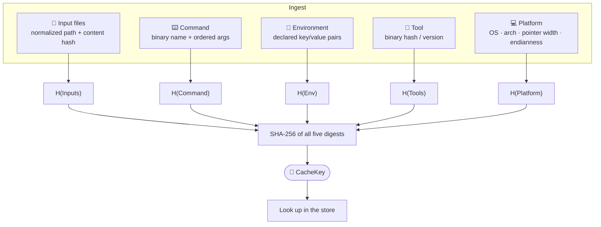

<br/>

### 💥 One change, a completely different key

SHA-256 has an avalanche property. Changing a single byte of any vector produces a key with no resemblance to the old one. That's why a key can't be "close" to another key, and why there is no partially stale hit.

```text
  hello.rs   fn main() { println!("hello"); }     →  9f01ab2c 4e7d…   (illustrative)
  hello.rs   fn main() { println!("hellp"); }     →  b83e5d10 a29c…   one character changed
```

<sub>These keys are illustrative. Real keys are 64 hex characters.</sub>

<br/>

### 🚧 What the key can't see

> [!WARNING]
> **The key covers what you declare.** Undeclared files the command reads, the current time, random numbers, network responses and undeclared environment variables are all invisible to it. If the output depends on any of them, a hit can be stale. Declare every input with `-i` and every relevant variable with `-e`, and don't cache commands whose output isn't deterministic. See the [Core Guarantee](#core-guarantee).

<table>
  <tr>
    <th width="50%" align="left">✅ Covered by the key</th>
    <th width="50%" align="left">⚠️ Your responsibility</th>
  </tr>
  <tr valign="top">
    <td>
      Contents of files passed with <code>-i</code><br/>
      Program name and all arguments, in order<br/>
      Variables passed with <code>-e</code><br/>
      The tool's binary or version<br/>
      OS, architecture, pointer width, endianness
    </td>
    <td>
      Files the command reads but you didn't list<br/>
      Variables the command reads but you didn't list<br/>
      Anything time-, random- or network-dependent<br/>
      Commands with side effects beyond their declared outputs
    </td>
  </tr>
</table>

<br/>

### 🧪 See each vector in action

Use the `hello.rs` demo from the [Quick Start](#quick-start-guide). Run each experiment after a first, unchanged run, so there is a cache entry to compare against.

**Baseline run (fills the cache):**

```bash
dcc exec -i hello.rs -o hello -- rustc hello.rs -o hello
```

#### 📄 Input change → miss

**Edit the source (Linux / macOS):**

```bash
echo 'fn main() { println!("changed"); }' > hello.rs
```

**Edit the source (Windows):**

```powershell
Set-Content hello.rs 'fn main() { println!("changed"); }'
```

**Run again:**

```bash
dcc exec -i hello.rs -o hello -- rustc hello.rs -o hello
```

Expect a **miss**, because the file's content hash changed. Restore the original text and run again for a **hit**.

#### ⌨️ Command change → miss

**Add an argument:**

```bash
dcc exec -i hello.rs -o hello -- rustc hello.rs -o hello -O
```

Expect a **miss**, because the argument list is part of the key.

#### 🌱 Declared variable change → miss

**Run with a declared variable (Linux / macOS):**

```bash
MODE=a dcc exec -i hello.rs -o hello -e MODE -- rustc hello.rs -o hello
```

**Change its value (Linux / macOS):**

```bash
MODE=b dcc exec -i hello.rs -o hello -e MODE -- rustc hello.rs -o hello
```

**Run with a declared variable (Windows):**

```powershell
$env:MODE="a"; dcc exec -i hello.rs -o hello.exe -e MODE -- rustc hello.rs -o hello.exe
```

**Change its value (Windows):**

```powershell
$env:MODE="b"; dcc exec -i hello.rs -o hello.exe -e MODE -- rustc hello.rs -o hello.exe
```

Expect a **miss** on the second run, because `MODE` is declared and its value changed.

#### 🙈 Undeclared variable change → still a hit

**Change a variable you did not declare (Linux / macOS):**

```bash
OTHER=1 dcc exec -i hello.rs -o hello -- rustc hello.rs -o hello
```

Expect a **hit**. `OTHER` isn't in the key, so changing it changes nothing. This is the boundary described above, made visible.

<sub>Check the outcome of any run with <code>dcc stats</code>. The exact log wording depends on the version.</sub>

<br/>

### 📐 Design notes

<table>
  <tr>
    <th width="30%" align="left">Choice</th>
    <th width="70%" align="left">Why</th>
  </tr>
  <tr valign="top">
    <td><b>Content hashes, not timestamps</b></td>
    <td>Timestamps change on checkouts and fresh clones without the content changing, and can stay the same when content does. Hashing bytes answers the real question.</td>
  </tr>
  <tr valign="top">
    <td><b>Hash each vector, then combine</b></td>
    <td>Fixed-width digests can't be confused with each other, so a value moving from one vector to another can't produce the same key.</td>
  </tr>
  <tr valign="top">
    <td><b>Declared environment only</b></td>
    <td>Hashing the whole environment would make the key change with every shell session. Declaring the relevant variables keeps keys stable and puts you in control.</td>
  </tr>
  <tr valign="top">
    <td><b>Hash the tool binary</b></td>
    <td>A compiler upgrade can change output with identical inputs. Including the tool makes stale results from an old version impossible.</td>
  </tr>
  <tr valign="top">
    <td><b>Include the platform</b></td>
    <td>The same source can compile to different bytes on different OSes or architectures, so results are never replayed across them.</td>
  </tr>
</table>

<br>

<a id="concurrency-and-single-flight-execution"></a>
## 🏎️ Concurrency & Single-Flight Execution

<div align="center">

```text
 ┌──────────────────────────────────────────────────────────────────────────────┐
 │  WITHOUT SINGLE-FLIGHT      three runners, same task                         │
 │                                                                              │
 │    A  ████████████████████                                                   │
 │    B  ████████████████████                                                   │
 │    C  ████████████████████         total work: 3 × the command's runtime     │
 │                                                                              │
 ├──────────────────────────────────────────────────────────────────────────────┤
 │  WITH SINGLE-FLIGHT         same three runners                               │
 │                                                                              │
 │    A  ████████████████████                                                   │
 │    B  ░░░░░░░░░░░░░░░░░░░░▒        total work: 1 × runtime + 2 small replays │
 │    C  ░░░░░░░░░░░░░░░░░░░░▒                                                  │
 │                                                                              │
 └──────────────────────────────────────────────────────────────────────────────┘

     ░ waiting on the lock     ▒ verify + replay     Illustrative, not to scale.
```

</div>

On a CI farm or a parallel build, several workers often ask for the same computation at the same moment. Without coordination, they all miss the cache together and all do the same work (the "thundering herd"). Reforge prevents this with **single-flight execution**: for each cache key, exactly one runner executes the command, and everyone else waits and reuses its result.

<br/>

### 🎬 Three runners, one key

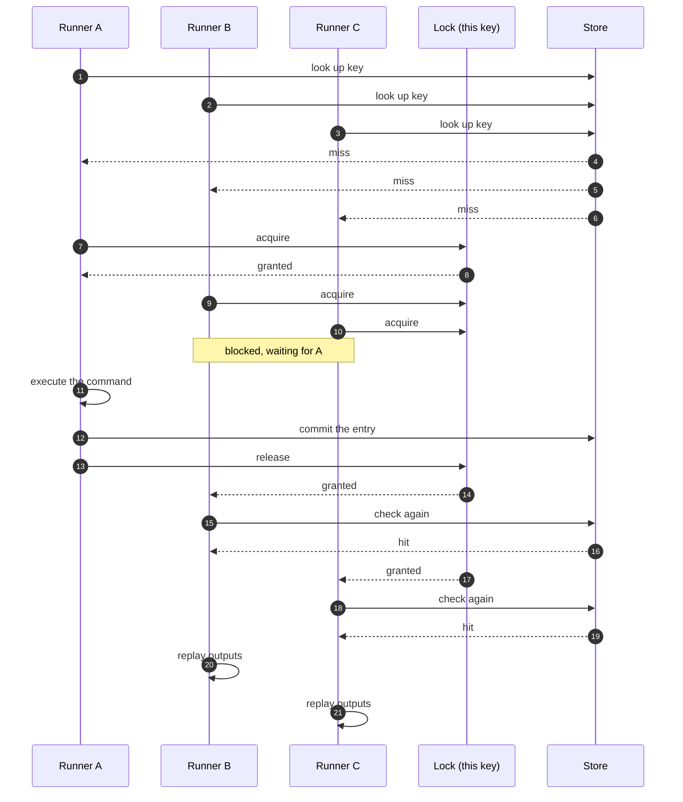

<sub>Waiters take the lock one at a time. Each one re-checks the store first, finds A's entry, and never runs the command.</sub>

<br/>

### 🧩 The three mechanisms

<table>
  <tr>
    <th width="24%" align="left">Mechanism</th>
    <th width="40%" align="left">How it works</th>
    <th width="36%" align="left">What it prevents</th>
  </tr>
  <tr valign="top">
    <td><b>🔐 Per-key advisory lock</b></td>
    <td>Each cache key has its own lock file in <code>.dcc/locks/</code>. The OS grants it to one runner at a time and makes the others wait.</td>
    <td>Duplicate execution of the same task across processes.</td>
  </tr>
  <tr valign="top">
    <td><b>🔁 Double-checked lookup</b></td>
    <td>After acquiring the lock, a runner looks in the store <b>again</b> before deciding to execute.</td>
    <td>A waiter re-running work that the previous lock holder just finished.</td>
  </tr>
  <tr valign="top">
    <td><b>🧯 Crash-safe release</b></td>
    <td>The OS releases the lock when its holder's process ends, including after <code>kill -9</code>.</td>
    <td>Stale locks and deadlocks after a worker dies mid-run.</td>
  </tr>
</table>

<br/>

### 🧭 What each runner decides

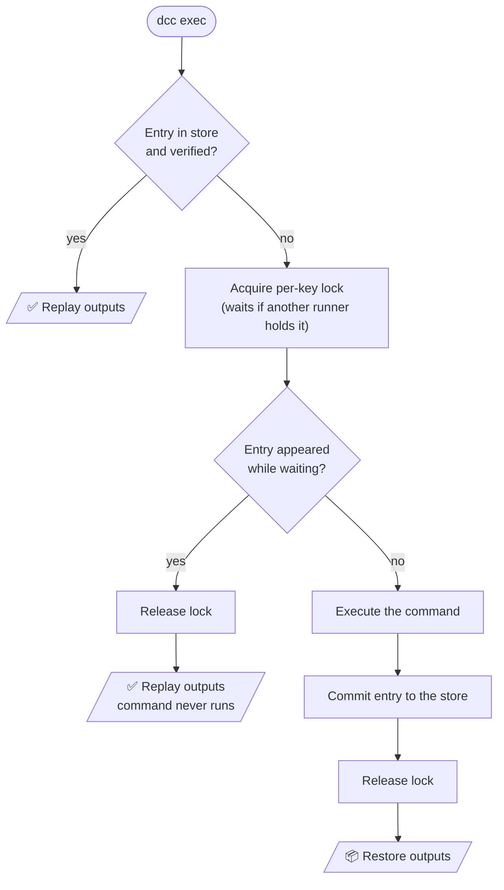

<sub>The first lookup makes ordinary hits fast, since they never touch the lock. The second one, after the lock is granted, is what makes the race safe.</sub>

<br/>

### 🔁 Why the second check matters

Between "I saw a miss" and "I got the lock", another runner may have finished the job.

<table>
  <tr>
    <th width="50%" align="left">❌ Without the re-check</th>
    <th width="50%" align="left">✅ With the re-check</th>
  </tr>
  <tr valign="top">
    <td>
      B sees a miss and waits for the lock.<br/>
      A finishes and releases it.<br/>
      B gets the lock and <b>runs the command again</b>, even though A's result is sitting in the store.
    </td>
    <td>
      B sees a miss and waits for the lock.<br/>
      A finishes and releases it.<br/>
      B gets the lock, <b>looks again</b>, finds A's entry, and replays it.
    </td>
  </tr>
</table>

<br/>

### 🛟 When things go wrong

<table>
  <tr>
    <th width="36%" align="left">Situation</th>
    <th width="64%" align="left">What happens</th>
  </tr>
  <tr valign="top">
    <td><b>The lock holder is killed</b> (<code>kill -9</code>, crash, power loss)</td>
    <td>The OS releases the lock. The next waiter gets it, re-checks, finds nothing stored, and executes the command itself. No manual cleanup.</td>
  </tr>
  <tr valign="top">
    <td><b>A lock file is left on disk</b></td>
    <td>Harmless. The file is only a name for the OS lock, and it isn't "held" unless a live process holds it.</td>
  </tr>
  <tr valign="top">
    <td><b>Runners want different keys</b></td>
    <td>They use different locks, so they run in parallel and never block each other.</td>
  </tr>
  <tr valign="top">
    <td><b>A stored object fails its checksum</b></td>
    <td>The entry is <a href="#self-healing--quarantine">quarantined</a> and treated as a miss, so the lock holder re-executes.</td>
  </tr>
</table>

<br/>

### 📏 Scope and limits

> [!NOTE]
> **Advisory locks coordinate cooperating processes.** They stop `dcc` runners from stepping on each other. They don't stop an unrelated program from touching the same files. Lock behaviour also depends on the filesystem, and locking on network filesystems (NFS, SMB) can be unreliable, so test before sharing one `.dcc/` directory across machines. Coordination is local to one cache directory. It doesn't span separate caches or separate hosts.

<table>
  <tr>
    <th width="50%" align="left">✅ Covered</th>
    <th width="50%" align="left">⚠️ Not covered</th>
  </tr>
  <tr valign="top">
    <td>
      Many <code>dcc</code> processes on one machine sharing a cache directory<br/>
      CI jobs running in parallel against the same workspace cache<br/>
      Crash of any runner at any point
    </td>
    <td>
      Runners on different machines with separate caches<br/>
      Non-<code>dcc</code> programs writing into the same files<br/>
      Shared network filesystems with unreliable locking
    </td>
  </tr>
</table>

<br/>

### 🧪 See it happen

A slow command makes the effect visible. This one takes about five seconds. Run it from an empty folder.

**Create an input file:**

```bash
echo data > input.txt
```

#### 🐧 Linux / macOS

**Start three identical runs at the same time:**

```bash
for i in 1 2 3; do dcc exec -i input.txt -o out.txt -- sh -c "sleep 5 && echo done > out.txt" & done; wait
```

**Check the counts:**

```bash
dcc stats
```

The three runs should finish in about five seconds total, not fifteen. `dcc stats` should show **one miss** and **two hits**.

#### 🪟 Windows

**Run this in three PowerShell windows within a second or two of each other:**

```powershell
dcc exec -i input.txt -o out.txt -- powershell -Command "Start-Sleep 5; 'done' | Out-File out.txt"
```

**Check the counts:**

```powershell
dcc stats
```

**Reset between attempts (Linux / macOS):**

```bash
rm -rf .dcc out.txt
```

**Reset between attempts (Windows):**

```powershell
Remove-Item -Recurse -Force .dcc, out.txt
```

<br/>

### 🔥 Stress test

The repository includes a test that races many processes on the same key.

**Run the concurrency suite:**

```bash
cargo test -p dcc-runner --test concurrency_tests
```

<br>

<a id="multi-strategy-eviction--gc"></a>
## ⚙️ Multi-Strategy Eviction & Garbage Collection

<div align="center">

```text
 ┌──────────────────────────────────────────────────────────────────────────────┐
 │                                                                              │
 │   DISK BUDGET   ██████████████████████████████████████░░░░░░░   over limit   │
 │                                                                              │
 │        │  1. EVICT    pick entries by strategy (LRU · LFU · FIFO)            │
 │        ▼                                                                     │
 │   DISK BUDGET   ████████████████████████░░░░░░░░░░░░░░░░░░░░░░   entries gone │
 │                                                                              │
 │        │  2. GC       delete objects no entry refers to anymore              │
 │        ▼                                                                     │
 │   DISK BUDGET   ██████████████████░░░░░░░░░░░░░░░░░░░░░░░░░░░░   under limit │
 │                                                                              │
 └──────────────────────────────────────────────────────────────────────────────┘

           Illustrative, not to scale.  █ used   ░ free
```

</div>

A cache that only grows will eventually fill your disk. Reforge keeps it within a size limit you set, in two stages. **Eviction** chooses which *entries* to drop. **Garbage collection** then deletes the *objects* that no remaining entry uses. Splitting the work this way is what makes it safe when entries share objects (see [CAS de-duplication](#content-addressable-storage-cas)).

<br/>

### 🎯 The three strategies

<table>
  <tr>
    <th width="14%" align="left">Strategy</th>
    <th width="30%" align="left">Evicts first</th>
    <th width="28%" align="left">Best when</th>
    <th width="28%" align="left">Watch out for</th>
  </tr>
  <tr valign="top">
    <td><b>🕐 LRU</b><br/><sub>Least Recently Used</sub></td>
    <td>The entry with the <b>oldest last-access</b> time.</td>
    <td>Work comes in phases: what you used lately is what you'll use next. A good default for developer machines.</td>
    <td>A long-idle entry that is normally popular can still be evicted.</td>
  </tr>
  <tr valign="top">
    <td><b>📊 LFU</b><br/><sub>Least Frequently Used</sub></td>
    <td>The entry with the <b>fewest total accesses</b>.</td>
    <td>A stable set of tasks is reused constantly, such as shared CI caches.</td>
    <td>New entries start with few accesses, so they can be evicted before they have had a chance to prove useful.</td>
  </tr>
  <tr valign="top">
    <td><b>📥 FIFO</b><br/><sub>First In, First Out</sub></td>
    <td>The entry with the <b>oldest creation</b> time.</td>
    <td>You want simple, predictable turnover and don't care about usage.</td>
    <td>It ignores use entirely, so a very popular entry can be evicted just because it's old.</td>
  </tr>
</table>

<br/>

### 🧮 Same cache, three different victims

Five entries, and the cache is over its limit. Each strategy ranks them differently.

<table>
  <tr>
    <th width="14%" align="left">Entry</th>
    <th width="22%" align="center">Created</th>
    <th width="22%" align="center">Last used</th>
    <th width="22%" align="center">Times used</th>
    <th width="20%" align="left">Note</th>
  </tr>
  <tr><td><b>A</b></td><td align="center">day 1</td><td align="center">day 9</td><td align="center">2</td><td>oldest entry</td></tr>
  <tr><td><b>B</b></td><td align="center">day 2</td><td align="center">day 3</td><td align="center">40</td><td>popular, but idle</td></tr>
  <tr><td><b>C</b></td><td align="center">day 3</td><td align="center">day 8</td><td align="center">5</td><td></td></tr>
  <tr><td><b>D</b></td><td align="center">day 4</td><td align="center">day 4</td><td align="center">1</td><td>used once</td></tr>
  <tr><td><b>E</b></td><td align="center">day 5</td><td align="center">day 10</td><td align="center">12</td><td>recent and used</td></tr>
</table>

<table>
  <tr>
    <th width="14%" align="left">Strategy</th>
    <th width="50%" align="left">Eviction order (first to go on the left)</th>
    <th width="36%" align="left">First victim</th>
  </tr>
  <tr valign="top">
    <td><b>🕐 LRU</b></td>
    <td><code>B → D → C → A → E</code></td>
    <td><b>B</b>: nothing has touched it since day 3, despite its 40 uses.</td>
  </tr>
  <tr valign="top">
    <td><b>📊 LFU</b></td>
    <td><code>D → A → C → E → B</code></td>
    <td><b>D</b>: it has been used only once.</td>
  </tr>
  <tr valign="top">
    <td><b>📥 FIFO</b></td>
    <td><code>A → B → C → D → E</code></td>
    <td><b>A</b>: it was created first, though it was used recently.</td>
  </tr>
</table>

<sub>Example data is made up to show the difference. Entries are removed in order until the cache is back under its limit.</sub>

<br/>

### 🔄 What a prune does

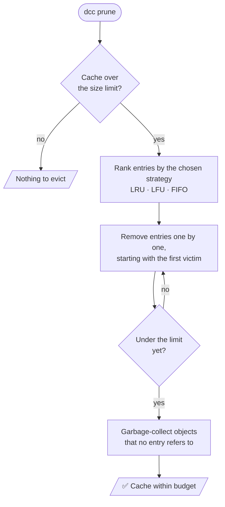

<br/>

### 🧹 Garbage collection: why it's a separate step

Removing an entry doesn't automatically free its objects. Another entry may still need them.

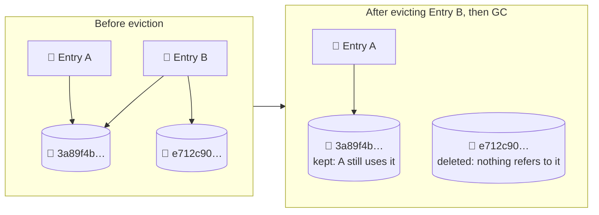

<table>
  <tr>
    <th width="30%" align="left">Object state</th>
    <th width="70%" align="left">What GC does</th>
  </tr>
  <tr valign="top">
    <td><b>Referenced by at least one entry</b></td>
    <td>Keeps it, even if other entries that shared it were evicted.</td>
  </tr>
  <tr valign="top">
    <td><b>Referenced by no entry</b></td>
    <td>Deletes it and frees the disk space.</td>
  </tr>
</table>

<br/>

### 🚪 Pre-insertion capacity check

Before storing a new object, Reforge checks it against the capacity limit. An object larger than the whole limit is rejected up front, and nothing else is disturbed.

<table>
  <tr>
    <th width="50%" align="left">❌ Without the check</th>
    <th width="50%" align="left">✅ With the check</th>
  </tr>
  <tr valign="top">
    <td>
      An oversized object arrives.<br/>
      Eviction removes entry after entry trying to make room.<br/>
      The object still doesn't fit, and <b>the useful cache is gone for nothing</b>.
    </td>
    <td>
      An oversized object arrives.<br/>
      It's rejected immediately.<br/>
      <b>The existing cache is untouched.</b>
    </td>
  </tr>
</table>

<br/>

### 🧭 Picking a strategy

<table>
  <tr>
    <th width="55%" align="left">Your situation</th>
    <th width="45%" align="left">Try</th>
  </tr>
  <tr valign="top"><td>Personal machine, work moves between projects and branches</td><td><code>lru</code></td></tr>
  <tr valign="top"><td>CI cache, the same tasks recur constantly</td><td><code>lfu</code></td></tr>
  <tr valign="top"><td>You want the simplest, most predictable turnover</td><td><code>fifo</code></td></tr>
  <tr valign="top"><td>Not sure</td><td><code>lru</code>, then check <code>dcc stats</code> and compare hit rates</td></tr>
</table>

<br/>

### 🛠️ Manage your cache

**See how full the cache is:**

```bash
dcc stats
```

**Preview a prune without deleting anything (always do this first):**

```bash
dcc prune --strategy lru --max-size-mb 500 --dry-run
```

**Prune with LRU:**

```bash
dcc prune --strategy lru --max-size-mb 500
```

**Prune with LFU:**

```bash
dcc prune --strategy lfu --max-size-mb 500
```

**Prune with FIFO:**

```bash
dcc prune --strategy fifo --max-size-mb 500
```

**Check the result:**

```bash
dcc stats
```

> [!TIP]
> Run the `--dry-run` command with each strategy and compare what each would remove. It's a safe way to see the differences from the table above on your own data.

<br/>

### 📏 Limits and behaviour to know

> [!NOTE]
> Eviction removes cached results, never your source files or real outputs. An evicted entry just turns into a **miss** the next time it's needed, and the command runs again. Eviction costs time, not correctness. A smaller limit means more misses, so size it to your working set.

<table>
  <tr>
    <th width="50%" align="left">✅ Guaranteed by the design</th>
    <th width="50%" align="left">⚠️ Worth knowing</th>
  </tr>
  <tr valign="top">
    <td>
      Objects shared by surviving entries are never deleted<br/>
      Oversized objects are rejected before insertion<br/>
      Strategies only change <i>which</i> entries go, not correctness<br/>
      <code>--dry-run</code> shows the plan before anything is removed
    </td>
    <td>
      An evicted entry costs a full re-run the next time<br/>
      LFU can penalize brand-new entries<br/>
      FIFO ignores how useful an entry is<br/>
      A limit smaller than your working set causes constant churn
    </td>
  </tr>
</table>
<br>

<a id="self-healing--quarantine"></a>
## 🛡️ Self-Healing & Quarantine

<div align="center">

```text
 ┌──────────────────────────────────────────────────────────────────────────────┐
 │                                                                              │
 │    📖 READ        🔍 CHECK           🚧 ISOLATE         ♻️ RECOVER         │
 │                                                                              │
 │   load object ──► SHA-256 matches ──► ✅ use it                              │
 │        │          the filename?                                              │
 │        │                                                                     │
 │        └────────► ❌ mismatch ──────► move to quarantine ──► re-run command  │
 │                                                          └─► store fresh     │
 │                                                              entry           │
 │                                                                              │
 └──────────────────────────────────────────────────────────────────────────────┘
      A bad entry costs one extra run. It never reaches your workspace.
```

</div>

Disks fail, power drops mid-write, and files get edited by accident. A cache that trusts what it reads would hand you corrupted output and call it a hit. Reforge doesn't trust the disk: every object is checked against its own hash before it's used. When a check fails, the entry is set aside and the command runs again, so the failure costs you time and not correctness.

<br/>

### 🔄 What happens on a failed check

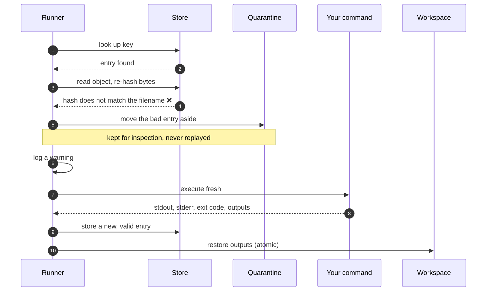

<br/>

### 🔍 What gets checked

<table>
  <tr>
    <th width="22%" align="left">Record</th>
    <th width="42%" align="left">How it's verified</th>
    <th width="36%" align="left">If it fails</th>
  </tr>
  <tr valign="top">
    <td><b>🧱 Objects</b><br/><sub><code>cas/objects/</code></sub></td>
    <td>The bytes are re-hashed with SHA-256 and compared to the object's filename, which is its expected hash. No extra bookkeeping is needed.</td>
    <td>The entry that uses it is quarantined and the command re-runs.</td>
  </tr>
  <tr valign="top">
    <td><b>📄 Entries</b><br/><sub><code>cas/entries/</code></sub></td>
    <td>Metadata linking a cache key to its object digests is validated when read. Unreadable or inconsistent metadata is handled like a bad object.</td>
    <td>Quarantined, then recomputed.</td>
  </tr>
</table>

<br/>

### 🩺 What it protects you from

<table>
  <tr>
    <th width="36%" align="left">What went wrong</th>
    <th width="34%" align="left">How it shows up</th>
    <th width="30%" align="left">Result</th>
  </tr>
  <tr valign="top">
    <td><b>Hardware fault or bit rot</b><br/>a flipped bit on disk</td>
    <td>The re-computed hash differs from the filename.</td>
    <td>Quarantined, re-run.</td>
  </tr>
  <tr valign="top">
    <td><b>Power loss or crash mid-write</b></td>
    <td>Bytes are cut short. Writes go through a temp file and an <a href="#content-addressable-storage-cas">atomic rename</a>, so a partial object normally never gets a real name. If one appears anyway, the hash catches it.</td>
    <td>Quarantined, re-run.</td>
  </tr>
  <tr valign="top">
    <td><b>Accidental hand-edit</b><br/>someone changed a file in <code>.dcc/</code></td>
    <td>The content no longer matches its name.</td>
    <td>Quarantined, re-run.</td>
  </tr>
  <tr valign="top">
    <td><b>Tampering with stored bytes</b></td>
    <td>Changed bytes give a different hash.</td>
    <td>Quarantined, re-run.</td>
  </tr>
</table>

<br/>

### 🧭 Three promises

<table>
  <tr>
    <td width="33%" valign="top">
      <h4>🚫 Never restored</h4>
      Data that fails its check is <b>never written into your workspace</b>. You either get verified bytes or a fresh run.
    </td>
    <td width="33%" valign="top">
      <h4>🗃️ Kept, not destroyed</h4>
      Bad entries are moved to <code>.dcc/cas/quarantine/</code>, not deleted. You can look at what went wrong, and the build isn't interrupted.
    </td>
    <td width="33%" valign="top">
      <h4>♻️ Recovers by itself</h4>
      A warning is logged, the command re-runs, and a fresh valid entry replaces the bad one. Nobody has to intervene.
    </td>
  </tr>
</table>

<br/>

### 🗂️ Working with quarantined entries

**List what's in quarantine:**

```bash
dcc quarantine list
```

**Scan the whole cache for corrupted objects, without waiting for a read to hit them:**

```bash
dcc verify
```

**Scan and recover bad entries:**

```bash
dcc verify --repair
```

**Empty the quarantine once you're done inspecting it:**

```bash
dcc quarantine clear
```

> [!NOTE]
> `dcc quarantine clear` deletes the quarantined files for good. If you want to investigate why data went bad, look first and clear afterwards.

<table>
  <tr>
    <th width="34%" align="left">Check</th>
    <th width="33%" align="left"><code>dcc verify</code> (proactive)</th>
    <th width="33%" align="left">Verify on read (automatic)</th>
  </tr>
  <tr valign="top">
    <td><b>When it runs</b></td>
    <td>When you run it</td>
    <td>Every time an object is used</td>
  </tr>
  <tr valign="top">
    <td><b>What it covers</b></td>
    <td>The whole cache</td>
    <td>Only the objects this run needs</td>
  </tr>
  <tr valign="top">
    <td><b>Good for</b></td>
    <td>After a crash, a disk scare or a restored backup</td>
    <td>Everyday safety, with no action from you</td>
  </tr>
</table>

<br/>

### 🧪 Try it: corrupt an object on purpose

Use the `hello.rs` demo from the [Quick Start](#quick-start-guide). You'll damage a stored object and watch Reforge notice.

**Fill the cache with a first run:**

```bash
dcc exec -i hello.rs -o hello -- rustc hello.rs -o hello
```

**Delete the output, so a replay has to restore it (Linux / macOS):**

```bash
rm hello
```

**Delete the output, so a replay has to restore it (Windows):**

```powershell
del hello.exe
```

**Corrupt one stored object by appending a byte (Linux / macOS):**

```bash
echo corrupt >> "$(find .dcc/cas/objects -type f | head -n 1)"
```

**Corrupt one stored object by appending a byte (Windows):**

```powershell
Add-Content (Get-ChildItem .dcc\cas\objects -Recurse -File | Select-Object -First 1).FullName "corrupt"
```

**Run the same command again:**

```bash
dcc exec -i hello.rs -o hello -- rustc hello.rs -o hello
```

Expect a warning, then a normal run. The output file is rebuilt from a fresh execution, not from the damaged object.

**See the quarantined entry:**

```bash
dcc quarantine list
```

**Confirm the cache is healthy again:**

```bash
dcc verify
```

<sub>On Windows, use <code>hello.exe</code> in place of <code>hello</code> in the <code>dcc exec</code> and <code>rustc</code> commands. The exact warning text depends on the version.</sub>

<br/>

### 📏 Scope and limits

> [!NOTE]
> **This detects changes. It doesn't stop them.** The checksum tells Reforge that stored data no longer
<br>

<a id="security--directory-escape-prevention"></a>
## 🔒 Security & Directory Escape Prevention

<div align="center">

```text
 ┌──────────────────────────────────────────────────────────────────────────────┐
 │                                                                              │
 │    📥 a path arrives            🚧 THREE CHECKS               📁 result     │
 │    (a flag, or a cache                                                       │
 │     entry being restored)                                                    │
 │                                                                              │
 │    ../../etc/passwd   ──►  1. absolute / ../ sanitized  ──►  ❌ rejected     │
 │    link/out.txt       ──►  2. symlinks resolved         ──►  ❌ rejected     │
 │    target/gen/a.rs    ──►  3. canonical path inside     ──►  ✅ written      │
 │                               workspace_dir?                                 │
 │                                                                              │
 └──────────────────────────────────────────────────────────────────────────────┘
      Only paths that end up inside the project workspace are ever written.
```

</div>

When Reforge restores a cached result, it writes files into your project. That is the moment a bad path could do damage: an output declared as `../../somewhere/else`, a folder that is secretly a symlink to a system directory, or a damaged or hostile cache entry that lists an absolute path. Reforge checks every output path before writing, and refuses anything that would land outside the workspace.

<br/>

### 🧱 The three protections

<table>
  <tr>
    <th width="22%" align="left">Protection</th>
    <th width="28%" align="left">The attack it stops</th>
    <th width="30%" align="left">How it works</th>
    <th width="20%" align="left">Outcome</th>
  </tr>
  <tr valign="top">
    <td><b>📍 Canonical path containment</b></td>
    <td>An output path that reaches outside the project through <code>..</code> or a roundabout route.</td>
    <td>Every declared output path is <b>canonicalized</b> (resolved to its one true absolute form) and must lie strictly inside <code>workspace_dir</code>.</td>
    <td>Rejected</td>
  </tr>
  <tr valign="top">
    <td><b>🔗 Symlink escape prevention</b></td>
    <td>Writing <i>through</i> a symlinked directory that points at <code>/etc</code>, <code>C:\Windows</code> or any other outside location.</td>
    <td>Outputs that pass through an intermediate directory symlink to an external location are refused.</td>
    <td>Rejected</td>
  </tr>
  <tr valign="top">
    <td><b>🧼 Absolute path sanitization</b></td>
    <td>A malicious or damaged cache entry that lists <code>/etc/cron.d/x</code> or <code>../../.ssh/authorized_keys</code> as an output.</td>
    <td>Absolute paths and <code>../</code> traversal tokens can't escape the designated root, even when they come from stored metadata and not from your command line.</td>
    <td>Rejected</td>
  </tr>
</table>

<br/>

### 🎬 Why canonicalizing first matters

A path that *looks* safe can point somewhere else once resolved.

<table>
  <tr>
    <th width="50%" align="left">Path as written</th>
    <th width="50%" align="left">Where it really goes</th>
  </tr>
  <tr valign="top">
    <td><code>gen/../../secrets.txt</code></td>
    <td>One folder <b>above</b> the project. It starts in <code>gen/</code> but climbs out.</td>
  </tr>
  <tr valign="top">
    <td><code>build/out.txt</code>, where <code>build</code> is a symlink to <code>/etc</code></td>
    <td><code>/etc/out.txt</code>, outside the workspace, although the text looks harmless.</td>
  </tr>
  <tr valign="top">
    <td><code>/home/you/.bashrc</code></td>
    <td>An absolute path with no relation to the project.</td>
  </tr>
</table>

Comparing the text of a path isn't enough. Reforge resolves the real destination first and judges that.

<br/>

### 🔄 What happens on each restore

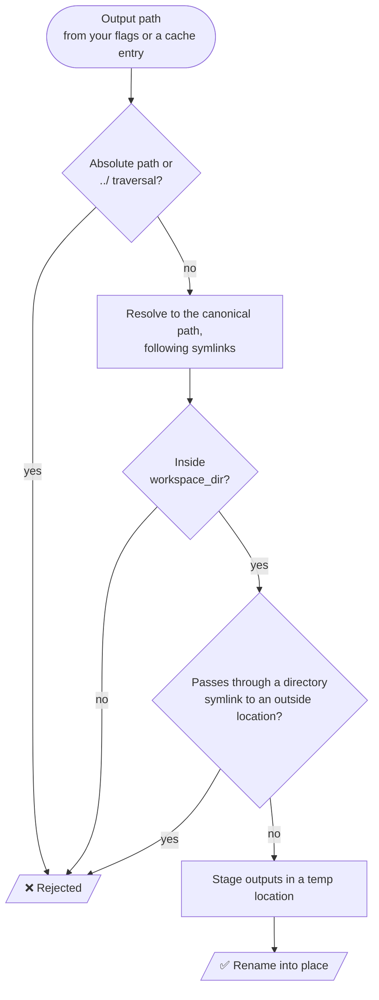

<br/>

### 🧭 Threat model

<table>
  <tr>
    <th width="34%" align="left">Who or what</th>
    <th width="66%" align="left">What Reforge does</th>
  </tr>
  <tr valign="top">
    <td><b>A mistaken flag</b><br/><sub>you typed <code>-o ../out</code></sub></td>
    <td>Rejects the path before anything is written outside the project.</td>
  </tr>
  <tr valign="top">
    <td><b>A damaged cache entry</b></td>
    <td>Verifies it, and rejects paths that would escape. See <a href="#self-healing--quarantine">Self-Healing &amp; Quarantine</a>.</td>
  </tr>
  <tr valign="top">
    <td><b>A hostile cache entry</b><br/><sub>a crafted entry that lists an escaping path</sub></td>
    <td>The path checks apply to restored entries too, so replaying one can't write outside the workspace.</td>
  </tr>
  <tr valign="top">
    <td><b>A symlink planted in the workspace</b></td>
    <td>Writes that would travel through it to an outside location are refused.</td>
  </tr>
</table>

<br/>

### 🚧 What this does not do

> [!IMPORTANT]
> **Reforge confines where it writes restored files. It does not sandbox the command you run.** The wrapped command executes with your normal user permissions and can read or write anything you can. Only run commands you trust, exactly as you would without `dcc`. Path confinement protects the *restore* step. It isn't process isolation.

<table>
  <tr>
    <th width="50%" align="left">✅ Covered</th>
    <th width="50%" align="left">⚠️ Not covered</th>
  </tr>
  <tr valign="top">
    <td>
      Output paths that climb out with <code>../</code><br/>
      Absolute output paths<br/>
      Directory symlinks leading outside the workspace<br/>
      Hostile paths inside stored cache entries
    </td>
    <td>
      What the command itself reads, writes or runs<br/>
      Files the command writes that you didn't declare with <code>-o</code><br/>
      Network access by the command<br/>
      Other users who can write to your <code>.dcc/</code> directory
    </td>
  </tr>
</table>

<br/>

### ✅ Practical guidance

<table>
  <tr>
    <th width="50%" align="left">Do</th>
    <th width="50%" align="left">Avoid</th>
  </tr>
  <tr valign="top">
    <td>
      Keep declared outputs inside the project folder.<br/>
      Keep <code>.dcc/</code> owned by you, with normal file permissions.<br/>
      Review commands before wrapping them in <code>dcc exec</code>.<br/>
      Run <code>dcc verify</code> after restoring a cache from backup or another source.
    </td>
    <td>
      Sharing a writable <code>.dcc/</code> with users or processes you don't trust.<br/>
      Copying a cache from an untrusted source and running with it as-is.<br/>
      Assuming <code>dcc</code> limits what the wrapped command can touch.
    </td>
  </tr>
</table>

<br/>

### 🧪 Try it: watch an escape get refused

Run these in an empty folder. Every command that should be refused is a safe test, because it uses harmless commands and creates nothing.

**Create an input file:**

```bash
echo data > input.txt
```

#### 🚫 Traversal: `../` in an output path

**Declare an output outside the workspace:**

```bash
dcc exec -i input.txt -o ../escaped.txt -- echo test
```

Expect a rejection with an error about the path leaving the workspace. Nothing should be created outside the folder.

**Confirm nothing was written (Linux / macOS):**

```bash
ls ../escaped.txt
```

**Confirm nothing was written (Windows):**

```powershell
dir ..\escaped.txt
```

Both should report that the file doesn't exist.

#### 🚫 Absolute path

**Declare an absolute output path (Linux / macOS):**

```bash
dcc exec -i input.txt -o /tmp/dcc-escape-test.txt -- echo test
```

**Declare an absolute output path (Windows):**

```powershell
dcc exec -i input.txt -o C:\Windows\Temp\dcc-escape-test.txt -- echo test
```

Expect a rejection.

#### 🚫 Symlink escape

**Create a folder outside the workspace and a symlink to it (Linux / macOS):**

```bash
mkdir ../outside && ln -s ../outside link
```

**Declare an output through the symlink:**

```bash
dcc exec -i input.txt -o link/out.txt -- echo test
```

**Check the outside folder stayed empty:**

```bash
ls ../outside
```

Expect a rejection, and an empty folder.

**Windows:** creating a symlink needs Developer Mode or an elevated prompt.

```powershell
mkdir ..\outside; cmd /c mklink /D link ..\outside
```

Then run the same `dcc exec` command as above, and check with `dir ..\outside`.

<sub>The exact error wording depends on the version. What matters is that the run is refused and nothing appears outside the workspace.</sub>

<br/>

### 🔬 Run the security test suite

**Run the security tests:**

```bash
cargo test -p dcc-runner --test security_tests
```


<br>

<a id="cli-command-reference"></a>
## 💻 CLI Command Reference

<div align="center">

```text
 ┌──────────────────────────────────────────────────────────────────────────────┐
 │                                                                              │
 │   dcc                                                                        │
 │    ├── exec         run a command with caching                               │
 │    ├── stats        show usage, hit/miss counts, capacity                    │
 │    ├── verify       check every stored object against its hash               │
 │    ├── prune        enforce a size limit (LRU · LFU · FIFO)                  │
 │    └── quarantine                                                            │
 │         ├── list    show entries that failed verification                    │
 │         └── clear   delete them for good                                     │
 │                                                                              │
 └──────────────────────────────────────────────────────────────────────────────┘
```

</div>

<br/>

### 🧭 At a glance

<table>
  <tr>
    <th width="22%" align="left">Command</th>
    <th width="46%" align="left">What it does</th>
    <th width="16%" align="center">Changes data?</th>
    <th width="16%" align="center">Jump to</th>
  </tr>
  <tr valign="top">
    <td><code>dcc exec</code></td>
    <td>Runs a command, or replays its stored result.</td>
    <td align="center">Yes (adds entries, writes outputs)</td>
    <td align="center"><a href="#cli-exec">↓</a></td>
  </tr>
  <tr valign="top">
    <td><code>dcc stats</code></td>
    <td>Shows cache usage, hit and miss counts, and capacity.</td>
    <td align="center">No</td>
    <td align="center"><a href="#cli-stats">↓</a></td>
  </tr>
  <tr valign="top">
    <td><code>dcc verify</code></td>
    <td>Scans the cache for corrupted objects.</td>
    <td align="center">Only with <code>--repair</code></td>
    <td align="center"><a href="#cli-verify">↓</a></td>
  </tr>
  <tr valign="top">
    <td><code>dcc prune</code></td>
    <td>Removes entries until the cache fits a size limit.</td>
    <td align="center">Yes (use <code>--dry-run</code> first)</td>
    <td align="center"><a href="#cli-prune">↓</a></td>
  </tr>
  <tr valign="top">
    <td><code>dcc quarantine</code></td>
    <td>Lists or clears entries that failed verification.</td>
    <td align="center"><code>list</code> no · <code>clear</code> yes</td>
    <td align="center"><a href="#cli-quarantine">↓</a></td>
  </tr>
</table>

<br/>

<a id="cli-exec"></a>
## ⚡ `dcc exec`: run a command with caching

**Syntax:**

```text
dcc exec [OPTIONS] -- <COMMAND> [ARGS]...
```

```text
  dcc exec   -i src/   -o gen/   -e MODE   --dir app   --   protoc --rust_out=gen a.proto
             │         │         │          │             │   └── everything after -- is your command
             │         │         │          │             └────── the separator: dcc's flags end here
             │         │         │          └──────────────────── where to run the command
             │         │         └─────────────────────────────── env variables that affect the result
             │         └───────────────────────────────────────── files the command writes
             └─────────────────────────────────────────────────── files the command reads
```

> [!IMPORTANT]
> **Always put `--` before your command.** It tells `dcc` where its own options end. Without it, flags meant for your command (like `-o` for `rustc`) could be read as `dcc` options.

<br/>

### 🎛️ Options

<table>
  <tr>
    <th width="27%" align="left">Option</th>
    <th width="43%" align="left">Meaning</th>
    <th width="30%" align="left">Part of the cache key?</th>
  </tr>
  <tr valign="top">
    <td><code>-i</code>, <code>--input &lt;PATH&gt;</code></td>
    <td>A file or directory the command <b>reads</b>. Repeat the flag for more than one.</td>
    <td>Yes. Contents are hashed.</td>
  </tr>
  <tr valign="top">
    <td><code>-o</code>, <code>--output &lt;PATH&gt;</code></td>
    <td>A file or directory the command <b>writes</b>. Captured after a run, restored on a hit.</td>
    <td>No. These are what gets stored.</td>
  </tr>
  <tr valign="top">
    <td><code>-e</code>, <code>--env &lt;VAR&gt;</code></td>
    <td>An environment variable whose value affects the result.</td>
    <td>Yes. Name and value are hashed.</td>
  </tr>
  <tr valign="top">
    <td><code>--dir &lt;PATH&gt;</code></td>
    <td>The working directory to run the command in. Defaults to the current directory.</td>
    <td>See the checklist below.</td>
  </tr>
  <tr valign="top">
    <td><code>--no-stdout</code></td>
    <td>Don't capture or replay standard output.</td>
    <td>See the checklist below.</td>
  </tr>
  <tr valign="top">
    <td><code>--no-stderr</code></td>
    <td>Don't capture or replay standard error.</td>
    <td>See the checklist below.</td>
  </tr>
</table>

<sub>Besides declared outputs, <code>dcc</code> also stores and replays the command's stdout, stderr and exit code, unless you turn those off. See <a href="#invalidation-engine--cryptographic-hashing">how the key is built</a>.</sub>

<br/>

### 📚 One example per option

**Minimal: one input, one output:**

```bash
dcc exec -i hello.rs -o hello -- rustc hello.rs -o hello
```

**Several inputs (repeat `-i`):**

```bash
dcc exec -i main.cpp -i include/ -o main.o -- clang++ -O3 -c main.cpp -o main.o
```

**Several outputs (repeat `-o`):**

```bash
dcc exec -i proto/ -o gen/ -o docs/api.md -- ./generate.sh
```

**A directory as an input (everything inside it is hashed):**

```bash
dcc exec -i src/ -o dist/ -- npx esbuild src/index.ts --bundle --outdir=dist
```

**Declare an environment variable that affects the result:**

```bash
dcc exec -i src/ -o dist/ -e NODE_ENV -- npx esbuild src/index.ts --bundle --outdir=dist
```

**Declare several variables (repeat `-e`):**

```bash
dcc exec -i src/ -o dist/ -e NODE_ENV -e API_URL -- ./build.sh
```

**Run in a different directory:**

```bash
dcc exec --dir app -i src/ -o dist/ -- npm run build
```

**Don't replay standard output:**

```bash
dcc exec --no-stdout -i input.txt -o out.txt -- ./process.sh
```

**Don't replay standard error:**

```bash
dcc exec --no-stderr -i input.txt -o out.txt -- ./process.sh
```

**Turn off both:**

```bash
dcc exec --no-stdout --no-stderr -i input.txt -o out.txt -- ./process.sh
```

> [!WARNING]
> **A hit is only as safe as your declarations.** Every file the command reads belongs under `-i`, every variable that changes its result belongs under `-e`, and every file it writes belongs under `-o`. See the [Core Guarantee](#core-guarantee).

<br/>

<a id="cli-stats"></a>
## 📊 `dcc stats`: see what's in the cache

**Syntax:**

```text
dcc stats [--json]
```

**Human-readable summary:**

```bash
dcc stats
```

**Machine-readable output for scripts:**

```bash
dcc stats --json
```

**Pretty-print the JSON with [`jq`](https://jqlang.org/), if you have it installed:**

```bash
dcc stats --json | jq .
```

Use it to check hit and miss counts, see how full the cache is against its limit, and confirm that a run behaved the way you expected.

<br/>

<a id="cli-verify"></a>
## 🔍 `dcc verify`: check integrity

**Syntax:**

```text
dcc verify [--repair]
```

**Scan the whole cache for corrupted objects:**

```bash
dcc verify
```

**Scan and recover bad entries:**

```bash
dcc verify --repair
```

Objects are re-hashed and compared with their names, as described in [Self-Healing &amp; Quarantine](#self-healing--quarantine). Run it after a crash, a disk scare or restoring a cache from a backup. Ordinary runs already verify what they read.

<br/>

<a id="cli-prune"></a>
## 🧹 `dcc prune`: enforce a size limit

**Syntax:**

```text
dcc prune --strategy <lru|lfu|fifo> --max-size-mb <MB> [--dry-run]
```

<table>
  <tr>
    <th width="27%" align="left">Option</th>
    <th width="73%" align="left">Meaning</th>
  </tr>
  <tr valign="top"><td><code>--strategy</code></td><td>Which entries go first: <code>lru</code> (least recently used), <code>lfu</code> (least frequently used) or <code>fifo</code> (oldest created). See <a href="#multi-strategy-eviction--gc">Eviction &amp; GC</a>.</td></tr>
  <tr valign="top"><td><code>--max-size-mb</code></td><td>The size limit, in megabytes.</td></tr>
  <tr valign="top"><td><code>--dry-run</code></td><td>Show what would be removed, and remove nothing.</td></tr>
</table>

**Preview first, always:**

```bash
dcc prune --strategy lru --max-size-mb 500 --dry-run
```

**Prune to 500 MB, least recently used first:**

```bash
dcc prune --strategy lru --max-size-mb 500
```

**Prune to 500 MB, least frequently used first:**

```bash
dcc prune --strategy lfu --max-size-mb 500
```

**Prune to 500 MB, oldest first:**

```bash
dcc prune --strategy fifo --max-size-mb 500
```

Pruning only removes cached results. A removed entry becomes a miss the next time it's needed, and the command runs again.

<br/>

<a id="cli-quarantine"></a>
## 🗃️ `dcc quarantine`: inspect isolated entries

**Syntax:**

```text
dcc quarantine <list|clear>
```

**See what failed verification:**

```bash
dcc quarantine list
```

**Delete the quarantined files permanently:**

```bash
dcc quarantine clear
```

> [!NOTE]
> Look with `list` before you `clear`. Clearing deletes the evidence of what went wrong.

<br/>

### 🔁 Common workflows

<table>
  <tr>
    <th width="36%" align="left">When you want to…</th>
    <th width="64%" align="left">Do this</th>
  </tr>
  <tr valign="top">
    <td><b>Cache a slow command</b></td>
    <td>Wrap it in <code>dcc exec</code> with <code>-i</code>, <code>-o</code> and <code>-e</code> declared.</td>
  </tr>
  <tr valign="top">
    <td><b>Check that caching works</b></td>
    <td>Run the same command twice, then <code>dcc stats</code>. Expect one miss and one hit.</td>
  </tr>
  <tr valign="top">
    <td><b>Keep the cache from growing</b></td>
    <td><code>dcc prune --dry-run</code> first, then the same command without the flag.</td>
  </tr>
  <tr valign="top">
    <td><b>Recover after a crash or a disk fault</b></td>
    <td><code>dcc verify</code>, then <code>dcc verify --repair</code> if it reports problems.</td>
  </tr>
  <tr valign="top">
    <td><b>Investigate corruption</b></td>
    <td><code>dcc quarantine list</code> before clearing anything.</td>
  </tr>
  <tr valign="top">
    <td><b>Feed numbers into a script or dashboard</b></td>
    <td><code>dcc stats --json</code>.</td>
  </tr>
</table>

<br/>

### 🚫 Common mistakes

<table>
  <tr>
    <th width="38%" align="left">Mistake</th>
    <th width="62%" align="left">What happens and how to fix it</th>
  </tr>
  <tr valign="top">
    <td>Leaving out <code>--</code></td>
    <td>Flags for your command can be confused with <code>dcc</code> options. Always separate them: <code>dcc exec … -- your-command</code>.</td>
  </tr>
  <tr valign="top">
    <td>Forgetting an input</td>
    <td>Editing that file doesn't invalidate the cache, and you get a stale hit. Declare everything the command reads.</td>
  </tr>
  <tr valign="top">
    <td>Forgetting an output</td>
    <td>The file isn't captured, so it's missing after a hit. Declare everything the command writes.</td>
  </tr>
  <tr valign="top">
    <td>Declaring a generated file as an input</td>
    <td>It changes every run, so you always get a miss.</td>
  </tr>
  <tr valign="top">
    <td>Pruning without <code>--dry-run</code></td>
    <td>Entries are removed with no preview. Preview first.</td>
  </tr>
  <tr valign="top">
    <td>Clearing quarantine too early</td>
    <td>The evidence is deleted. Run <code>list</code> first.</td>
  </tr>
</table>

<br/>

### 🧾 Quick reference

<table>
  <tr>
    <th width="52%" align="left">Command</th>
    <th width="48%" align="left">Purpose</th>
  </tr>
  <tr valign="top"><td><code>dcc exec [OPTIONS] -- &lt;COMMAND&gt; [ARGS]...</code></td><td>Run with caching</td></tr>
  <tr valign="top"><td><code>dcc stats [--json]</code></td><td>Usage and hit/miss metrics</td></tr>
  <tr valign="top"><td><code>dcc verify [--repair]</code></td><td>Integrity scan, optionally repair</td></tr>
  <tr valign="top"><td><code>dcc prune --strategy &lt;lru|lfu|fifo&gt; --max-size-mb &lt;MB&gt; [--dry-run]</code></td><td>Enforce capacity</td></tr>
  <tr valign="top"><td><code>dcc quarantine list</code></td><td>Show quarantined entries</td></tr>
  <tr valign="top"><td><code>dcc quarantine clear</code></td><td>Delete quarantined entries</td></tr>
</table>


<br>

<a id="polyglot-integrations"></a>

## 🔌 Polyglot Integrations

### One Execution Model. Any Toolchain.

`dcc` is language-agnostic by design.

It does not replace your compiler, bundler, generator, test runner, or static analyzer. Instead, it sits **around the existing command** and adds deterministic computation caching to workflows that were never designed with caching in mind.

Whether the workload is Rust compilation, a C++ translation unit, a TypeScript bundle, or a Python analysis pass, the execution model remains the same:

```text
                    ┌──────────────────────────────┐
                    │        Developer Task        │
                    │  Build · Generate · Test · CI│
                    └──────────────┬───────────────┘
                                   │
                                   ▼
                    ┌──────────────────────────────┐
                    │          dcc exec            │
                    │                              │
                    │  Hash → Resolve → Lock →     │
                    │  Execute / Replay → Restore  │
                    └──────────────┬───────────────┘
                                   │
                     ┌─────────────┴─────────────┐
                     │                           │
                  CACHE HIT                  CACHE MISS
                     │                           │
                     ▼                           ▼
              CAS Replay                  Run Original Tool
              + Output Restore             + Capture Outputs
                     │                           │
                     └─────────────┬─────────────┘
                                   ▼
                         Deterministic Result
```

### 🧩 Supported Workflow Patterns

| Ecosystem               | Typical Workload                              | What `dcc` Tracks                                   | Example Tool |
| :---------------------- | :-------------------------------------------- | :-------------------------------------------------- | :----------- |
| 🦀 **Rust**             | Compilation, code generation, tests           | Source tree, arguments, environment, toolchain      | `cargo`      |
| ⚙️ **C / C++**          | Translation units, generated artifacts        | Source/header inputs, compiler flags, tool identity | `clang++`    |
| 🌐 **Web / TypeScript** | Bundling and asset generation                 | Source tree, package metadata, build arguments      | `esbuild`    |
| 🐍 **Python**           | Static analysis, linting, generated artifacts | Package sources, configuration, environment         | `mypy`       |

> **The integration boundary stays intentionally thin:** `dcc` observes the declared inputs and outputs, while the underlying tool remains responsible for the actual computation.

---

### 🦀 Rust / Cargo

Cache expensive compilation, code-generation, or test workflows without changing the underlying Cargo command.

```bash
dcc exec \
  -i src/ \
  -o target/out.bin \
  -- cargo build --release
```

**Execution flow:**

```text
src/
 │
 ├── Rust source files
 ├── Cargo configuration
 └── declared build inputs
        │
        ▼
   dcc CacheKey
        │
   ┌────┴────┐
   │         │
  MISS      HIT
   │         │
   ▼         ▼
 cargo     CAS Replay
 build     + Restore
```

---

### ⚙️ C / C++ / CMake

Cache standalone compiler invocations while incorporating both source files and header dependencies into the declared input set.

```bash
dcc exec \
  -i main.cpp \
  -i include/ \
  -o main.o \
  -- clang++ -O3 -c main.cpp -o main.o
```

Changing a tracked source/header or compiler argument produces a different cache key, preventing the previous result from being reused.

---

### 🌐 Web / TypeScript

Cache deterministic frontend build and bundling operations across JavaScript/TypeScript projects.

```bash
dcc exec \
  -i src/ \
  -i package.json \
  -o dist/ \
  -- npx esbuild src/index.ts \
     --bundle \
     --outdir=dist
```

This allows unchanged source trees and build parameters to replay previously generated artifacts directly from the local CAS.

---

### 🐍 Python

Cache static-analysis workflows where repeatedly scanning an unchanged package would otherwise perform the same computation.

```bash
dcc exec \
  -i my_package/ \
  -o .mypy_cache/ \
  -- mypy my_package/
```

The same execution model applies to compatible linters, analyzers, generators, and other deterministic command-line workloads.

---

### 🔗 The Common Interface

Regardless of the ecosystem, integration follows one consistent pattern:

```text
dcc exec
   │
   ├── -i  Input files / directories
   ├── -o  Expected output files / directories
   ├── -e  Environment variables
   │
   └── --  Original command + arguments
```

That means teams do not need a separate caching implementation for every language.

```text
        Rust       C/C++       TypeScript       Python
          │           │             │              │
          └───────────┴─────────────┴──────────────┘
                              │
                              ▼
                         ┌─────────┐
                         │   dcc   │
                         └────┬────┘
                              │
                ┌─────────────┴─────────────┐
                ▼                           ▼
           Cache Miss                  Cache Hit
        Execute Normally             Replay from CAS
```

### 💡 Why This Matters

`dcc` is intentionally positioned **below the language layer and above the operating-system process boundary**.

Your build system, compiler, bundler, generator, or analyzer continues doing what it already does. `dcc` adds the missing execution layer around it:

* **No language-specific cache format required**
* **No rewrite of the underlying tool**
* **One CLI model across multiple ecosystems**
* **Content-addressed result storage**
* **Deterministic invalidation**
* **Cross-process duplicate-execution prevention**
* **Atomic output restoration**

> **Bring the command. `dcc` decides whether it needs to run.**


<br>

<a id="milestone-roadmap--audit-matrix"></a>

## 📋 20-Point Definition of Done & Engineering Audit Matrix

### From Feature Completion to Engineering Verification

Reforge is not considered complete simply because its features are implemented.

Each milestone represents a **specific engineering capability that has been implemented, exercised, and verified through dedicated automated test suites** — covering correctness, concurrency, storage integrity, security, failure recovery, reliability, and performance.

The result is a verification trail spanning the complete execution lifecycle:

```text
┌─────────────────────────────────────────────────────────────────────────────┐
│                        REFORGE VERIFICATION PIPELINE                        │
├─────────────────────────────────────────────────────────────────────────────┤
│                                                                             │
│  FOUNDATION       DETERMINISM       CONCURRENCY       STORAGE               │
│      │                 │                 │                │                 │
│      ▼                 ▼                 ▼                ▼                 │
│   M1 ─ M4          M5.1 ─ M5.5       M6.1 ─ M6.5       M7 ─ M10             │
│      │                 │                 │                │                 │
│      └─────────────────┴─────────────────┴────────────────┘                 │
│                              │                                              │
│                              ▼                                              │
│                         INTEGRATIONS                                        │
│                              │                                              │
│                           M11 ─ M13                                         │
│                              │                                              │
│              ┌───────────────┴────────────────┐                             │
│              ▼                                ▼                             │
│          SECURITY                         RESILIENCE                        │
│        M14.1 ─ M14.3                    M15 ─ M17                           │
│              │                                │                             │
│              └───────────────┬────────────────┘                             │
│                              ▼                                              │
│                    END-TO-END VERIFICATION                                  │
│                         M18 ─ M19                                           │
│                              │                                              │
│                              ▼                                              │
│                    RELEASE ASSURANCE                                        │
│                    M20.1 ─ M20.3                                            │
│                              │                                              │
│                              ▼                                              │
│                       ┌────────────┐                                        │
│                       │ VERIFIED   │                                        │
│                       │ ENGINE     │                                        │
│                       └────────────┘                                        │
└─────────────────────────────────────────────────────────────────────────────┘
```

### 🧪 Milestone Verification Matrix

| Milestone       | Engineering Capability            | Verification Focus                                                                            | Test Suite                         |    Status    |
| :-------------- | :-------------------------------- | :-------------------------------------------------------------------------------------------- | :--------------------------------- | :----------: |
| **M1–M4**       | 🧱 **Core Foundation**            | Domain models, SHA-256 digest ingestion, cache-key construction and invalidation              | `unit_tests_milestone_18_2`        | **PASSED** ✅ |
| **M5.1–M5.5**   | 🔐 **Deterministic Invalidation** | Input files, command arguments, environment variables, tool versions and platform state       | `integration_tests`                | **PASSED** ✅ |
| **M6.1–M6.5**   | ⚡ **Single-Flight Concurrency**   | Lock acquisition, contention handling and 50-process concurrent execution                     | `concurrency_tests`                | **PASSED** ✅ |
| **M7–M10**      | 📦 **CAS & Storage Lifecycle**    | Content-addressable storage, eviction strategies, capacity enforcement and garbage collection | `eviction_tests`                   | **PASSED** ✅ |
| **M11–M13**     | 🔌 **Polyglot Integrations**      | Build-tool integrations and benchmark-based speedup analysis                                  | `cache-integrations`               | **PASSED** ✅ |
| **M14.1–M14.3** | 🛡️ **Security Hardening**        | Directory traversal rejection, symlink escape prevention and filesystem boundary enforcement  | `security_tests`                   | **PASSED** ✅ |
| **M15–M17**     | 🧯 **Failure Recovery**           | Failure injection, chaos recovery and corrupted-entry quarantine                              | `failure_injection_tests`          | **PASSED** ✅ |
| **M18–M19**     | 🔄 **End-to-End Reliability**     | Complete workflow lifecycles and high-load same-key writers                                   | `concurrency_suite_18_4`           | **PASSED** ✅ |
| **M20.1**       | 🧬 **Release Integrity**          | Release-quality validation, metadata self-healing and corrupted CAS recovery                  | `release_audit_milestone_20`       | **PASSED** ✅ |
| **M20.2**       | 💪 **Reliability Assurance**      | Process-crash resilience and strict capacity-bound verification                               | `reliability_audit_20_2`           | **PASSED** ✅ |
| **M20.3**       | 🚀 **Performance Assurance**      | Execution overhead measurement and cache speedup verification                                 | `performance_audit_milestone_20_3` | **PASSED** ✅ |

---

### 🔍 What the Audit Covers

The milestone matrix intentionally progresses from **internal correctness to real-world operational behavior**:

```text
                    ┌───────────────────────┐
                    │   CORE CORRECTNESS    │
                    │ Models + Hashing      │
                    └───────────┬───────────┘
                                │
                                ▼
                    ┌───────────────────────┐
                    │ DETERMINISTIC CACHE   │
                    │ Key + Invalidation    │
                    └───────────┬───────────┘
                                │
                                ▼
                    ┌───────────────────────┐
                    │ CONCURRENT EXECUTION  │
                    │ Locks + Single Flight │
                    └───────────┬───────────┘
                                │
                                ▼
                    ┌───────────────────────┐
                    │ STORAGE INTEGRITY     │
                    │ CAS + GC + Eviction   │
                    └───────────┬───────────┘
                                │
                                ▼
                    ┌───────────────────────┐
                    │ SECURITY & RECOVERY   │
                    │ Isolation + Healing   │
                    └───────────┬───────────┘
                                │
                                ▼
                    ┌───────────────────────┐
                    │ RELEASE ASSURANCE     │
                    │ Reliability + Perf.   │
                    └───────────────────────┘
```

### ✅ Definition of Done

A milestone is considered verified when its associated implementation and automated verification suite have completed successfully.

The audit therefore evaluates more than the **happy path**. It explicitly exercises:

* Deterministic cache-key generation
* Multi-dimensional invalidation
* Concurrent same-key execution
* CAS integrity and object lifecycle
* Capacity and eviction behavior
* Filesystem boundary enforcement
* Symlink and traversal rejection
* Corruption detection and quarantine
* Process-failure recovery
* End-to-end execution lifecycles
* Release integrity
* Performance and cache-speedup behavior

> **The goal is not simply to prove that Reforge works.**
>
> **The goal is to continuously verify the conditions under which Reforge is allowed to trust a cached computation.**

### 🏁 Audit Status

```text
╔══════════════════════════════════════════════════════════╗
║                  REFORGE AUDIT STATUS                    ║
╠══════════════════════════════════════════════════════════╣
║  Engineering Milestones        20+                       ║
║  Verification Areas            Correctness → Performance ║
║  Automated Suites              Dedicated per capability  ║
║  Reported Milestone Status     PASSED                    ║
╚══════════════════════════════════════════════════════════╝
```

The milestone matrix represents the project's current **engineering verification record**, rather than a claim that every possible workload or environment has been exhaustively tested.


<br>

<a id="testing--verification"></a>
## 🧪 Testing & Verification

<div align="center">

```text
 ┌──────────────────────────────────────────────────────────────────────────────────┐
 │                                                                                  │
 │   Every guarantee in this README has a test suite behind it.                     │
 │                                                                                  │
 │   🔒 key invalidation   🏎️ concurrency   🛡️ self-healing   🔐 security         │
 │   ⚙️ eviction           🔌 integrations   📋 release, reliability,performance  │
 │                                                                                  │
 └──────────────────────────────────────────────────────────────────────────────────┘
```

</div>

Reforge's promises (a hit never changes the result, racing runners share one execution, corrupt data is never replayed, outputs can't escape the workspace) are each checked by automated tests. You can run all of them at once or one guarantee at a time.

<br/>

### ▶️ Run everything

**All unit and integration tests across the workspace:**

```bash
cargo test --workspace
```

<br/>

### 🎯 Run one guarantee at a time

<table>
  <tr>
    <th width="27%" align="left">Suite</th>
    <th width="43%" align="left">What it checks</th>
    <th width="30%" align="left">Guarantee</th>
  </tr>
  <tr valign="top">
    <td><code>security_tests</code></td>
    <td>Output paths can't escape the workspace: <code>../</code> traversal, absolute paths and symlink escapes are rejected.</td>
    <td><a href="#security--directory-escape-prevention">Security</a></td>
  </tr>
  <tr valign="top">
    <td><code>concurrency_tests</code></td>
    <td>Many processes racing on one key: lock contention, one execution, the rest replay.</td>
    <td><a href="#concurrency-and-single-flight-execution">Single-flight</a></td>
  </tr>
  <tr valign="top">
    <td><code>failure_injection_tests</code></td>
    <td>Injected crashes and corrupted bytes: detection, quarantine and recovery.</td>
    <td><a href="#self-healing--quarantine">Self-healing</a></td>
  </tr>
  <tr valign="top">
    <td><code>release_audit_milestone_20</code></td>
    <td>Release-quality audit, including metadata self-healing and corrupted CAS data.</td>
    <td><a href="#content-addressable-storage-cas">CAS</a></td>
  </tr>
  <tr valign="top">
    <td><code>reliability_audit_milestone_20_2</code></td>
    <td>Process-crash resilience and capacity bounds.</td>
    <td><a href="#multi-strategy-eviction--gc">Eviction</a></td>
  </tr>
  <tr valign="top">
    <td><code>performance_audit_milestone_20_3</code></td>
    <td>Overhead and speedup verification.</td>
    <td><a href="#benchmark-reforge-vs-traditional-caches">Performance</a></td>
  </tr>
</table>

**Security and directory-escape prevention:**

```bash
cargo test -p dcc-runner --test security_tests
```

**Concurrency and lock contention:**

```bash
cargo test -p dcc-runner --test concurrency_tests
```

**Failure injection and chaos self-healing:**

```bash
cargo test -p dcc-runner --test failure_injection_tests
```

**Release audit:**

```bash
cargo test -p dcc-runner --test release_audit_milestone_20
```

**Reliability audit:**

```bash
cargo test -p dcc-runner --test reliability_audit_milestone_20_2
```

**Performance audit (build in release mode so timings are meaningful):**

```bash
cargo test -p dcc-runner --test performance_audit_milestone_20_3 --release
```

<sub>The full milestone breakdown is in the <a href="#milestone-roadmap--audit-matrix">audit matrix</a>.</sub>

<br/>

### 🏗️ Run one crate

**Core (keys and hashing):**

```bash
cargo test -p dcc-core
```

**Storage (CAS, eviction, quarantine):**

```bash
cargo test -p dcc-storage
```

**Runner (execution, locking, restore):**

```bash
cargo test -p dcc-runner
```

<br/>

### 🔧 When a test fails

<table>
  <tr>
    <th width="42%" align="left">You want to…</th>
    <th width="58%" align="left">Add this to the command</th>
  </tr>
  <tr valign="top"><td>See printed output from passing tests</td><td><code>-- --nocapture</code></td></tr>
  <tr valign="top"><td>Run tests one at a time</td><td><code>-- --test-threads=1</code></td></tr>
  <tr valign="top"><td>Run only tests whose name contains a word</td><td><code>-- &lt;name&gt;</code></td></tr>
  <tr valign="top"><td>List the tests in a suite without running them</td><td><code>-- --list</code></td></tr>
  <tr valign="top"><td>Get a full stack trace on a panic</td><td>set <code>RUST_BACKTRACE=1</code></td></tr>
</table>

**Show output while a suite runs:**

```bash
cargo test -p dcc-runner --test concurrency_tests -- --nocapture
```

**Run one suite single-threaded (useful if you suspect timing interference):**

```bash
cargo test -p dcc-runner --test security_tests -- --test-threads=1
```

**List the tests in a suite:**

```bash
cargo test -p dcc-runner --test failure_injection_tests -- --list
```

**Run only tests with "symlink" in their name:**

```bash
cargo test -p dcc-runner --test security_tests -- symlink
```

**Get a full backtrace (Linux / macOS):**

```bash
RUST_BACKTRACE=1 cargo test -p dcc-runner --test concurrency_tests
```

**Get a full backtrace (Windows):**

```powershell
$env:RUST_BACKTRACE=1; cargo test -p dcc-runner --test concurrency_tests
```

<br/>

### 📏 What the tests do and don't tell you

> [!NOTE]
> Passing tests show that Reforge behaves as specified on the machine that ran them. They don't prove that your own `dcc exec` commands are declared correctly. A missing `-i` is invisible to any test suite, so review declarations as described in the [Core Guarantee](#core-guarantee). Timing-based suites, such as concurrency and performance, can vary with machine load. If one fails once, re-run it before assuming a regression.


<br>

<a id="cross-platform-support"></a>
## 🌐 Cross-Platform Support

<div align="center">

<table>
  <tr>
    <td align="center" width="33%"><h3>🪟</h3><b>Windows</b><br/><sub>x86_64 · MSVC</sub></td>
    <td align="center" width="33%"><h3>🍎</h3><b>macOS</b><br/><sub>Apple Silicon · Intel</sub></td>
    <td align="center" width="33%"><h3>🐧</h3><b>Linux</b><br/><sub>x86_64 · aarch64</sub></td>
  </tr>
</table>

</div>

Reforge is written in Rust and designed to run natively on all three. It uses the operating system's own file locking, atomic rename and path handling, and it doesn't depend on a Unix shell.

<!-- Once a CI workflow runs the test suite on all three OSes, replace the sentence above with:
"Reforge's test suite runs on Windows, macOS and Linux on every push." and add the CI badge. -->

<br/>

### 🧭 What differs by platform

<table>
  <tr>
    <th width="22%" align="left">Area</th>
    <th width="26%" align="left">🪟 Windows</th>
    <th width="26%" align="left">🍎 macOS / 🐧 Linux</th>
    <th width="26%" align="left">What to do</th>
  </tr>
  <tr valign="top">
    <td><b>Output names</b></td>
    <td>Programs end in <code>.exe</code></td>
    <td>No extension</td>
    <td>Declare the real filename with <code>-o</code>.</td>
  </tr>
  <tr valign="top">
    <td><b>Symlinks</b></td>
    <td>Creating them needs Developer Mode or an elevated prompt</td>
    <td>Available to any user</td>
    <td>Only matters for the <a href="#security--directory-escape-prevention">symlink demos</a>.</td>
  </tr>
  <tr valign="top">
    <td><b>Path separators</b></td>
    <td><code>\</code> and <code>/</code></td>
    <td><code>/</code></td>
    <td>Use forward slashes in scripts you share across systems.</td>
  </tr>
  <tr valign="top">
    <td><b>Filename case</b></td>
    <td>Usually case-insensitive</td>
    <td>Linux is case-sensitive. macOS usually isn't.</td>
    <td>Keep casing consistent so the same command hashes the same paths everywhere.</td>
  </tr>
  <tr valign="top">
    <td><b>Shell in your command</b></td>
    <td>PowerShell or <code>cmd</code></td>
    <td>sh, bash or zsh</td>
    <td>Wrap the tool directly (<code>cargo</code>, <code>rustc</code>) instead of shell one-liners where you can.</td>
  </tr>
</table>

<br/>

### 🔁 Caches don't cross platforms

The [cache key](#invalidation-engine--cryptographic-hashing) includes the OS, architecture, pointer width and endianness. A result built on Linux is never replayed on Windows or macOS, or on a different CPU architecture. That's intentional, since the same source can compile to different bytes on each. It does mean each platform builds its own cache.

<br/>

### ⚠️ Filesystem caveats

> [!NOTE]
> [Locking](#concurrency-and-single-flight-execution) and [atomic renames](#content-addressable-storage-cas) work as designed on local disks. Network filesystems (NFS, SMB) and some synced folders can behave differently, so keep `.dcc/` on a local drive and don't share one writable cache directory over a network without testing it first.

<br/>

### ✅ Check it on your machine

**Build:**

```bash
cargo build --workspace
```

**Run the tests:**

```bash
cargo test --workspace
```

**Run the concurrency suite, which exercises locking on your OS:**

```bash
cargo test -p dcc-runner --test concurrency_tests
```

**Run the security suite, which exercises path handling on your OS:**

```bash
cargo test -p dcc-runner --test security_tests
```

Found a difference on your platform? Please [open an issue](https://github.com/Ashish6298/Reforge/issues) with your OS, architecture and the command you ran.

<br>

<a id="license"></a>
## 📄 License & Contributing

### License

Reforge is dual-licensed. You may use it under **either** of these licenses, whichever suits your project:

<div align="center">

[**⚖️ &nbsp;MIT License**](LICENSE-MIT) &nbsp;&nbsp;·&nbsp;&nbsp; [**📜 &nbsp;Apache License 2.0**](LICENSE-APACHE)

<sub>MIT is short and simple. Apache-2.0 adds an explicit patent grant.</sub>

</div>

| | MIT | Apache-2.0 |
| :--- | :--- | :--- |
| Style | Very short and simple | Longer and more detailed |
| Commercial use, modification, redistribution | Allowed | Allowed |
| Explicit patent grant | No | Yes |
| Keep copyright and license notice | Yes | Yes, and mark files you changed |
| Often chosen when | You want the simplest terms | You want the patent protection |

This table is a summary to help you choose, not legal advice. The license files are what count.

Unless you explicitly state otherwise, any contribution you intentionally submit for inclusion in Reforge, as defined in the Apache-2.0 license, will be dual-licensed as above, without any additional terms or conditions.

<br>

## Contributing

Contributions of every kind are welcome: bug reports, fixes, tests, documentation and ideas.

| Contribution | What helps most |
| :--- | :--- |
| **Report a bug** | Your OS and architecture, the exact `dcc exec` command, what you expected and what happened. A stale cache hit is a real bug: say which file wasn't declared. |
| **Propose a feature** | Describe the problem first, then your idea. For anything touching cache keys, eviction or path checks, open an issue before writing code. |
| **Send a fix** | One change per pull request, with a test for any behaviour you change. Small pull requests get reviewed fastest. |
| **Improve the docs** | Try the Quick Start and fix whatever doesn't work. Typos, unclear steps and missing examples all count. |
| **Add tests** | Failure cases especially: corrupted data, crashes mid-run, unusual paths and platform differences. |

Open an issue here: [github.com/Ashish6298/Reforge/issues](https://github.com/Ashish6298/Reforge/issues)

---

### Set up your workspace

Fork the repository on GitHub, then clone your fork:

```bash
git clone https://github.com/<your-username>/Reforge.git
```

Enter the folder:

```bash
cd Reforge
```

Create a branch:

```bash
git checkout -b my-change
```

Build everything:

```bash
cargo build --workspace
```

Run the tests (before and after your change):

```bash
cargo test --workspace
```

Format the code:

```bash
cargo fmt --all
```

Lint it:

```bash
cargo clippy --workspace --all-targets
```

Push your branch, then open a pull request on GitHub:

```bash
git push origin my-change
```

---

### Pull request checklist

- [ ] The change does one thing.
- [ ] `cargo test --workspace` passes.
- [ ] New or changed behaviour has a test.
- [ ] `cargo fmt` and `cargo clippy` are clean.
- [ ] The README is updated if a command or behaviour changed.
- [ ] You say which OS you tested on.
- [ ] No safety check was weakened (hash verification, path confinement, locking).
- [ ] Any change to cache-key rules is explained, since it invalidates users' caches.

---

### Areas that need extra care

| If you change | Keep in mind |
| :--- | :--- |
| **Cache key rules** (`crates/cache-core`) | A change can silently invalidate every user's cache, or keep a stale one. Discuss it in an issue first. |
| **Storage and eviction** (`crates/cache-storage`) | Objects shared by surviving entries must not be deleted, and every read must stay verified. |
| **Locking, restore and paths** (`crates/cache-runner`) | Outputs must never land outside the workspace, and a killed runner must never leave the cache stuck. |

---

### Reporting a security issue

Please don't open a public issue for a vulnerability. Contact the maintainer privately through the [GitHub profile](https://github.com/Ashish6298) first, and include what you found, how to reproduce it and which platform you used. Public disclosure can wait until a fix is ready.

<br>

<div align="center">

**Reforge**

*Built with ❤️ in Rust for high-performance developer workflows.*

</div>
